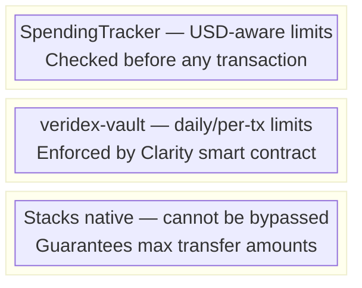
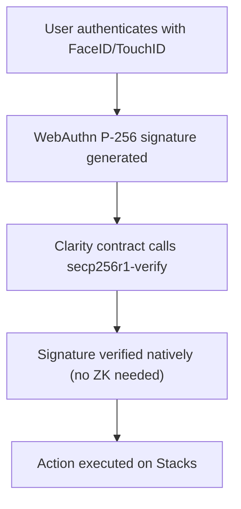
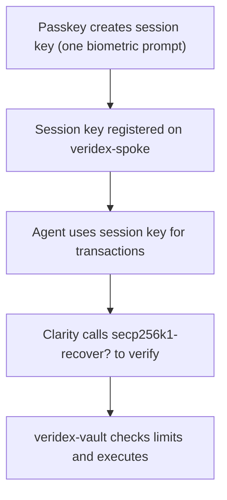

# Stacks

Veridex supports Stacks as a spoke chain with native passkey verification via Clarity's built-in `secp256r1-verify`.

## Why Stacks?

Stacks is uniquely suited for Veridex because of three native Clarity features:

| Feature | Benefit |
|---------|---------|
| **`secp256r1-verify`** | Native P-256 passkey signature verification — no ZK proofs needed |
| **`secp256k1-recover?`** | Native session key verification |
| **Sponsored transactions** | Gasless operations — relayer pays STX fees |
| **Post-Conditions** | Protocol-level spending safety unique to Stacks |

## Chain Configuration

| Property | Testnet | Mainnet |
|----------|---------|---------|
| **CAIP-2 ID** | `stacks:2147483648` | `stacks:1` |
| **Wormhole Chain ID** | 50003 | 50004 |
| **RPC URL** | `https://api.testnet.hiro.so` | `https://api.hiro.so` |
| **Explorer** | `explorer.hiro.so/?chain=testnet` | `explorer.hiro.so` |
| **Native Token** | STX | STX |

## SDK Integration

### Core SDK

```typescript
import { createSDK, StacksClient } from '@veridex/sdk';

// Initialize for Stacks testnet
const sdk = createSDK('stacks', { network: 'testnet' });

// Register passkey (verified on-chain via secp256r1-verify)
const credential = await sdk.passkey.register('alice', 'My Stacks Wallet');

// Get vault address
const vault = sdk.getVaultAddress();
```

### Agent SDK

```typescript
import { StacksChainClient, StacksSpendingTracker } from '@veridex/agentic-payments';

// Stacks-specific chain client with Pyth pricing
const client = new StacksChainClient({ network: 'testnet' });

// Get real-time STX price
const stxPrice = await client.getNativeTokenPriceUSD();
console.log('STX/USD:', stxPrice);

// USD-aware spending tracker
const tracker = new StacksSpendingTracker({
  dailyLimitUSD: 100,
  network: 'testnet',
});

// Convert microSTX to USD
const usdValue = await tracker.convertToUSD(1000000n, 'STX'); // 1 STX
```

### Stacks Utilities

The SDK exports Stacks-specific utilities:

```typescript
import {
  // Address utilities
  isValidStacksPrincipal,
  isValidStacksStandardPrincipal,
  isValidStacksContractName,
  getStacksNetworkFromAddress,
  getStacksContractPrincipal,
  parseStacksContractPrincipal,
  isStacksContractPrincipal,
  getStacksExplorerTxUrl,
  getStacksExplorerAddressUrl,

  // Cryptographic utilities
  stacksCompressPublicKey,
  stacksRsToCompactSignature,
  stacksDerToCompactSignature,
  stacksComputeKeyHash,
  stacksComputeKeyHashFromCoords,

  // Hash builders for contract interactions
  stacksBuildRegistrationHash,
  stacksBuildSessionRegistrationHash,
  stacksBuildRevocationHash,
  stacksBuildExecuteHash,
  stacksBuildWithdrawalHash,

  // Post-condition builders
  buildStxWithdrawalPostConditions,
  buildStxDepositPostConditions,
  buildSbtcWithdrawalPostConditions,
  buildStacksExecutePostConditions,
  validateStacksPostConditions,
} from '@veridex/sdk';
```

## Deployed Contracts

All contracts are deployed on Stacks testnet:

| Contract | Address |
|----------|---------|
| **vault-trait** | `ST1CKNN84MDPCJRQDHDCY34GMRKQ3TASNNDJQDRTN.vault-trait` |
| **session-trait** | `ST1CKNN84MDPCJRQDHDCY34GMRKQ3TASNNDJQDRTN.session-trait` |
| **veridex-session-verifier** | `ST1CKNN84MDPCJRQDHDCY34GMRKQ3TASNNDJQDRTN.veridex-session-verifier` |
| **veridex-spoke** | `ST1CKNN84MDPCJRQDHDCY34GMRKQ3TASNNDJQDRTN.veridex-spoke` |
| **veridex-vault** | `ST1CKNN84MDPCJRQDHDCY34GMRKQ3TASNNDJQDRTN.veridex-vault` |
| **veridex-wormhole-verifier** | `ST1CKNN84MDPCJRQDHDCY34GMRKQ3TASNNDJQDRTN.veridex-wormhole-verifier` |
| **veridex-vault-vaa** | `ST1CKNN84MDPCJRQDHDCY34GMRKQ3TASNNDJQDRTN.veridex-vault-vaa` |

## Architecture

### Three-Layer Spending Limits

Stacks provides a unique three-layer spending safety model:



### Passkey Flow on Stacks



### Session Key Flow



## Post-Conditions

Stacks Post-Conditions are a protocol-level safety feature. They guarantee that a transaction will fail if it transfers more than the specified amount.

```typescript
import {
  buildStxWithdrawalPostConditions,
  validateStacksPostConditions,
} from '@veridex/sdk';

// Build post-conditions for a withdrawal
const postConditions = buildStxWithdrawalPostConditions({
  vaultAddress: 'ST1CKNN84MDPCJRQDHDCY34GMRKQ3TASNNDJQDRTN.veridex-vault',
  amount: 1000000n, // 1 STX in microSTX
});

// Validate post-conditions before submitting
const validation = validateStacksPostConditions(postConditions);
if (!validation.valid) {
  console.warn('Post-condition issues:', validation.warnings);
}
```

## Gasless Transactions

Stacks supports native sponsored transactions. The relayer can pay STX gas fees on behalf of users:

```typescript
// The relayer handles sponsorship automatically
// Users never need to hold STX for gas
const sdk = createSDK('stacks', {
  network: 'testnet',
  relayerUrl: 'https://relayer.veridex.network',
});
```

### Relayer Sponsorship Limits

| Limit | Value |
|-------|-------|
| Per-identity rate | 50 tx/hour |
| Per-tx fee cap | 0.5 STX |
| Hourly budget | 50 STX |

## x402 on Stacks

The Stacks x402 integration uses the `x402-stacks` protocol for HTTP payment gating:

```typescript
import { createAgentWallet, StacksChainClient } from '@veridex/agentic-payments';

const agent = await createAgentWallet({
  masterCredential: { /* ... */ },
  session: {
    dailyLimitUSD: 50,
    perTransactionLimitUSD: 10,
    expiryHours: 24,
  },
});

// Agent automatically handles x402 payments in STX
const response = await agent.fetch('https://stacks-data-api.example.com/market');
```

## Testnet Faucet

Get testnet STX from the Stacks faucet:

- [Stacks Testnet Faucet](https://explorer.hiro.so/sandbox/faucet?chain=testnet)

## Next Steps

<Cards>
  <Card title="Agent SDK" href="/api-reference/agent-sdk">
    Build autonomous agents on Stacks
  </Card>
  <Card title="Session Keys" href="/guides/session-keys">
    Configure session keys for Stacks
  </Card>
  <Card title="Spending Limits" href="/guides/spending-limits">
    Set up three-layer spending limits
  </Card>
</Cards>
