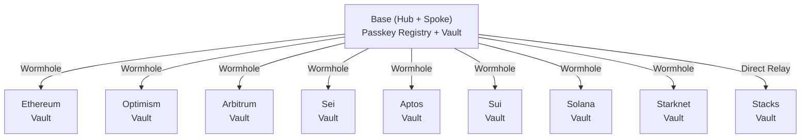
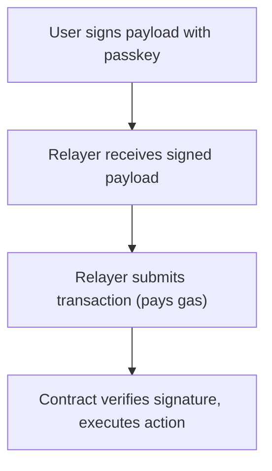
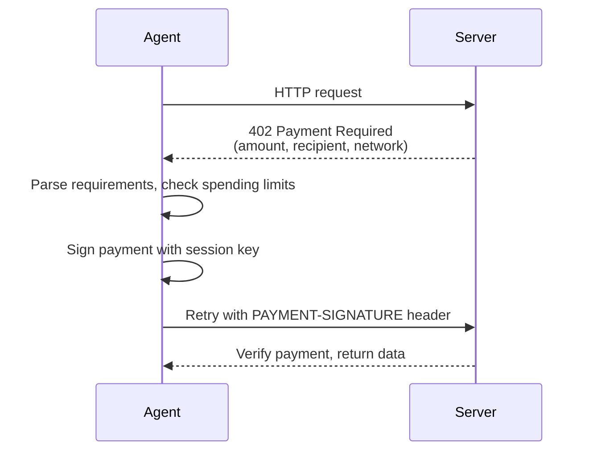

# Core Concepts

Understanding the fundamental concepts of Veridex will help you build better integrations.

## Passkeys (WebAuthn)

Passkeys are a modern authentication standard that replaces passwords with biometrics (FaceID, TouchID) or hardware security keys.

### How Passkeys Work

```
User taps "Connect" → Device prompts for biometric → 
Passkey signs challenge → Signature verified on-chain
```

### Key Properties

- **Phishing-resistant**: Passkeys are bound to domains
- **Cross-device**: Sync via iCloud Keychain, Google Password Manager
- **Non-exportable**: Private key never leaves the device

### Cryptography

Veridex uses the **P-256 (secp256r1)** curve, supported natively by:

- WebAuthn standard
- RIP-7212 precompile on Base/Optimism/Arbitrum
- All modern secure enclaves (TPM, Secure Enclave)

## Cross-Domain Passkeys

By default, WebAuthn passkeys are bound to a single domain. A passkey created on `app-a.com` cannot be used on `app-b.com`. Veridex solves this with **Related Origin Requests (ROR)** — a WebAuthn Level 3 standard that allows passkeys to be shared across approved domains.

### How It Works

1. All Veridex-integrated apps use `veridex.network` as the canonical **Relying Party ID (rpId)**.
2. A `.well-known/webauthn` file at `veridex.network` lists all approved origins.
3. When a user visits a third-party app, the browser checks the whitelist and allows the passkey if the origin is listed.
4. For browsers without ROR support, the SDK falls back to an **Auth Portal** at `auth.veridex.network` (popup or redirect).

### Key Points for Developers

- **Register your origin** at [developers.veridex.network](https://developers.veridex.network) before integrating.
- **Use `createCrossOriginAuth()`** from the SDK — it handles ROR detection and fallback automatically.
- **Create server-side session tokens** via the relayer for backend-verifiable sessions.
- **HTTPS is required** — WebAuthn does not work on insecure origins (except `localhost`).
- **Chrome limits** `.well-known/webauthn` to 5 unique eTLD+1 labels. Origins beyond this limit use the Auth Portal fallback seamlessly.

See the [Cross-Domain Passkeys Guide](/guides/cross-domain-passkeys) for full integration instructions.

## Hub and Spoke Architecture

Veridex uses a hub-and-spoke model for cross-chain operations.



### Hub (Base)

- Stores passkey credentials (public key, credential ID)
- Verifies WebAuthn signatures (P-256)
- Emits cross-chain authorization messages
- Single source of truth for identity
- **Also functions as a Spoke** — can hold funds and execute transactions directly (no cross-chain hop needed for Base operations)

### Spokes (All Chains)

- Hold user assets in deterministic vaults
- Execute actions upon receiving Hub authorization via Wormhole (or direct relay for Stacks)
- Support native token + ERC20/SPL/SIP-010 transfers

## Deterministic Vaults

Each passkey generates a **deterministic vault address** that's the same across all EVM chains.

### How It Works

```typescript
vaultAddress = CREATE2(
  factory,
  keccak256(publicKeyX, publicKeyY),
  vaultBytecode
)
```

### Benefits

- **Single address**: Share one address for all EVM chains
- **No deployment needed**: Address is known before vault exists
- **Counterfactual**: Can receive funds before vault is deployed

### Non-EVM Chains

For Solana, Aptos, Sui, Starknet, and Stacks, vault addresses are derived using chain-specific methods but still deterministic from the passkey.

**Stacks** is unique because Clarity natively supports `secp256r1-verify` for passkey signatures — no ZK proofs or precompiles needed.

## Session Keys

Session keys enable smooth UX by delegating limited authority to a temporary key.

### Why Session Keys?

Without session keys:
```
Action 1 → Biometric prompt
Action 2 → Biometric prompt
Action 3 → Biometric prompt
```

With session keys:
```
Create session → Biometric prompt (once)
Action 1 → Auto-signed
Action 2 → Auto-signed
Action 3 → Auto-signed
```

### Session Constraints

Sessions can be limited by:

| Constraint | Description |
|------------|-------------|
| `duration` | Time limit (e.g., 1 hour) |
| `maxValue` | Total value limit |
| `allowedTokens` | Whitelist of tokens |
| `allowedRecipients` | Whitelist of addresses |

### Core SDK Session Example

```typescript
import { SessionManager, generateSecp256k1KeyPair, computeSessionKeyHash } from '@veridex/sdk';

// Generate a session key pair
const keyPair = generateSecp256k1KeyPair();
const sessionHash = computeSessionKeyHash(keyPair.publicKey);

// SessionManager handles lifecycle
const sessionManager = new SessionManager({ /* hub client config */ });
```

### Agent SDK Session Example

The Agent SDK provides a higher-level `SessionKeyManager` with USD-denominated spending limits:

```typescript
import { createAgentWallet } from '@veridex/agentic-payments';

const agent = await createAgentWallet({
  masterCredential: { /* passkey credential */ },
  session: {
    dailyLimitUSD: 50,           // $50/day budget
    perTransactionLimitUSD: 10,  // $10 max per tx
    expiryHours: 24,             // 24-hour session
    allowedChains: [10004],      // Base Sepolia only
  },
});

// Agent uses session key automatically for payments
await agent.pay({ chain: 10004, token: 'USDC', amount: '1000000', recipient: '0x...' });
```

## Cross-Chain Messaging

Veridex uses Wormhole for secure cross-chain communication.

### Message Flow

1. **Hub signs action** → WebAuthn signature verified
2. **Wormhole guardians attest** → 13/19 signatures required
3. **Spoke verifies VAA** → Executes authorized action

### Verification Paths

| Path | Speed | Use Case |
|------|-------|----------|
| **Query (CCQ)** | ~5-7 seconds | Balance checks, low-value transfers |
| **VAA** | ~60 seconds | High-value transfers, critical actions |

The relayer automatically chooses the optimal path based on transaction value.

## Gasless Transactions

Users never need to hold gas tokens — the relayer pays gas fees.

### How It Works



### Fee Model

- **User pays**: Token amount only
- **Relayer pays**: Gas fees
- **Relayer recovers**: Via protocol fee or sponsorship

## Security Model

### Trust Assumptions

| Component | Trust Level |
|-----------|-------------|
| User's device | Fully trusted (holds passkey) |
| Hub contract | Trustless (on-chain verification) |
| Wormhole guardians | Honest majority (13/19) |
| Relayer | Untrusted (can't forge signatures) |

### Attack Resistance

- **Replay attacks**: Nonces prevent replay
- **Cross-chain replay**: Chain ID in signature
- **Signature malleability**: Canonical encoding enforced
- **Phishing**: Passkeys are domain-bound

## Agent SDK Concepts

The Agent SDK (`@veridex/agentic-payments`) extends the core SDK for autonomous AI agent operations.

### AgentWallet

The central orchestration class that manages session keys, x402 payments, spending limits, and audit logging.

```typescript
import { createAgentWallet } from '@veridex/agentic-payments';

const agent = await createAgentWallet(config);
```

### x402 HTTP Payment Protocol

The x402 protocol enables AI agents to pay for API access automatically:



### Spending Limits (Three Layers)

Veridex enforces spending limits at three levels:

| Layer | Enforcement | Description |
|-------|------------|-------------|
| **SDK** | Off-chain | `SpendingTracker` checks USD limits before signing |
| **Contract** | On-chain | Smart contract enforces daily/per-tx limits |
| **Post-Conditions** | Protocol (Stacks only) | Stacks native guarantee on max transfer amounts |

### MCP Tools

The Agent SDK provides Model Context Protocol (MCP) tools for integration with AI assistants like Claude and Cursor:

```typescript
const agent = await createAgentWallet({
  // ...
  mcp: { enabled: true },
});

const tools = agent.getMCPTools();
// Tools: check_balance, send_payment, get_session_status, etc.
```

### Pyth Oracle

Real-time price feeds for USD-denominated spending limits:

```typescript
import { PythOracle } from '@veridex/agentic-payments';

const oracle = new PythOracle();
const ethPrice = await oracle.getPrice('ETH');
const stxPrice = await oracle.getPrice('STX');
```

## Next Steps

<Cards>
  <Card title="Create Wallet" href="/guides/create-wallet">
    Step-by-step wallet creation guide
  </Card>
  <Card title="Agent Payments" href="/guides/agent-payments">
    Build autonomous AI agent payments
  </Card>
  <Card title="SDK Reference" href="/api-reference/sdk">
    Explore the SDK API
  </Card>
  <Card title="Stacks Integration" href="/chains/stacks">
    Native passkey support on Stacks
  </Card>
</Cards>
