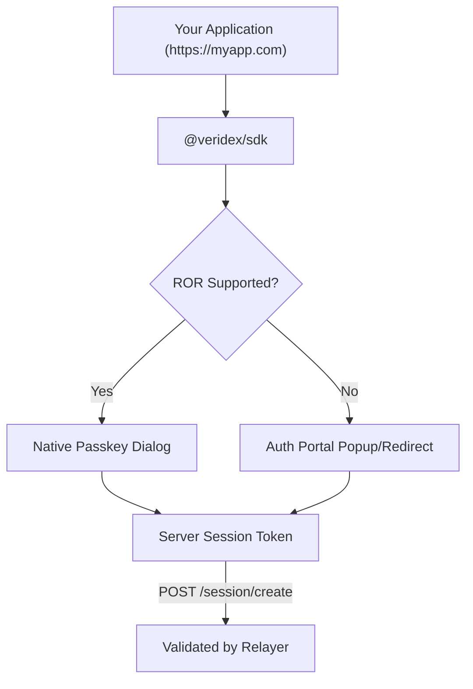

# Cross-Domain Passkey Integration

This guide explains how third-party applications can enable Veridex passkey authentication, allowing users to sign in with passkeys they've already created on `veridex.network`.

## Overview

Veridex supports a "Google-style" authentication flow that works across all domains. Users carry their identity (and assets) to your application without creating new accounts.

Two methods are supported, and the SDK handles both automatically:

1. **Related Origin Requests (ROR)** — The modern WebAuthn Level 3 standard. If the user's browser supports ROR and your origin is listed in the `.well-known/webauthn` file, the passkey dialog appears natively. No popup needed.
2. **Auth Portal Fallback** — A popup/redirect flow via `auth.veridex.network`. Works on all browsers. The user signs with their passkey at the portal, and a session is returned to your app.

<Callout type="info">
  You don't need to choose between these methods. The SDK detects browser support and picks the best flow automatically.
</Callout>

---

## Quick Start

### Step 1: Register Your App

Every third-party origin must be registered before it can use Veridex cross-domain passkeys. Registration is free and instant.

**Option A: Developer Portal (UI)**

1. Go to the [Developer Portal](https://developers.veridex.network).
2. Enter your **Application Name**, **Origin** (e.g., `https://myapp.com`), and optionally a **Contact Email**.
3. You'll receive an **App ID** and **API Key**. Save the API key — it's shown only once.

**Option B: API**

```bash
curl -X POST https://relayer.veridex.network/api/v1/apps/register \
  -H "Content-Type: application/json" \
  -d '{
    "name": "My DeFi App",
    "origin": "https://myapp.com",
    "contactEmail": "dev@myapp.com"
  }'
```

**Response:**

```json
{
  "success": true,
  "app": {
    "id": "app_a1b2c3d4e5f6",
    "name": "My DeFi App",
    "origin": "https://myapp.com",
    "apiKey": "vdx_sk_...",
    "trustLevel": "registered",
    "status": "active"
  }
}
```

<Callout type="warning">
  **Save your API Key immediately.** It is only shown once during registration. You'll need it to manage your app or delete it later.
</Callout>

### Step 2: Install the SDK

```bash
npm install @veridex/sdk
```

### Step 3: Implement Authentication

```typescript
import { createCrossOriginAuth } from '@veridex/sdk';

const auth = createCrossOriginAuth();

async function signIn() {
  try {
    // The SDK automatically detects ROR support and falls back to Auth Portal
    if (await auth.supportsRelatedOrigins()) {
      // Seamless: native passkey dialog, no popup
      const result = await auth.authenticate();
      console.log('Signed in (ROR):', result.credential.keyHash);
      return result;
    }

    // Fallback: popup to auth.veridex.network
    const session = await auth.connectWithVeridex();
    console.log('Signed in (Portal):', session.address);
    return session;
  } catch (error) {
    console.error('Sign in failed:', error);
  }
}
```

### Step 4: Create a Server Session (Recommended)

After authentication, create a **server-validated session token** via the relayer. This gives you a token that your backend can verify independently.

```typescript
const auth = createCrossOriginAuth();

async function signInWithServerSession() {
  // Full flow: authenticate + create server-validated session
  const { session, serverSession } = await auth.authenticateAndCreateSession({
    permissions: ['read', 'transfer'],
    expiresInMs: 3600000, // 1 hour
  });

  console.log('Vault address:', session.address);
  console.log('Server session ID:', serverSession.id);
  console.log('Expires at:', new Date(serverSession.expiresAt));

  // Store the session ID for subsequent API calls
  localStorage.setItem('veridex_session_id', serverSession.id);
}
```

You can validate this session from your backend at any time:

```bash
curl https://relayer.veridex.network/api/v1/session/ses_abc123
```

---

## How It Works

### Architecture



### The User Experience

1. User clicks **"Connect with Veridex"** on your site.
2. **If ROR is supported**: The browser's native passkey dialog appears immediately. User verifies with biometrics. Done.
3. **If ROR is not supported**:
   - A popup opens to `auth.veridex.network`.
   - User sees a clean "Sign in to [Your App]" card (your app name from registration).
   - User verifies with their passkey.
   - Popup closes and returns the session to your app.

### What You Get Back

After authentication, you receive a `CrossOriginSession` containing:

| Field | Type | Description |
|-------|------|-------------|
| `address` | `string` | User's vault address (same on all EVM chains) |
| `sessionPublicKey` | `string` | Session key for signing transactions |
| `expiresAt` | `number` | Session expiry timestamp (ms) |
| `signature` | `WebAuthnSignature` | Proof of passkey ownership |
| `credential` | `PasskeyCredential` | The credential used (keyHash, publicKey) |
| `serverSessionId` | `string?` | Server-validated session ID (if created) |

---

## Configuration Options

### `createCrossOriginAuth`

```typescript
import { createCrossOriginAuth } from '@veridex/sdk';

const auth = createCrossOriginAuth({
  // The canonical Relying Party ID. Must be 'veridex.network' for cross-domain.
  rpId: 'veridex.network', // default

  // Auth Portal URL for popup/redirect flow.
  authPortalUrl: 'https://auth.veridex.network', // default

  // Relayer API URL for server-side session tokens.
  relayerUrl: 'https://relayer.veridex.network/api/v1', // default

  // Authentication mode: 'popup' (default) or 'redirect'.
  // Use 'redirect' for mobile browsers where popups might be blocked.
  mode: 'popup',

  // URL to redirect back to (only for mode: 'redirect').
  redirectUri: 'https://myapp.com/callback',

  // Timeout for auth operations (ms). Default: 120000 (2 minutes).
  timeout: 120000,
});
```

### Redirect Mode

If using `mode: 'redirect'`, handle the callback on your `redirectUri` page:

```typescript
// pages/callback.tsx
import { createCrossOriginAuth } from '@veridex/sdk';
import { useEffect } from 'react';

export default function Callback() {
  useEffect(() => {
    const auth = createCrossOriginAuth();
    const session = auth.completeRedirectAuth();

    if (session) {
      localStorage.setItem('veridex_session', JSON.stringify(session));
      window.location.href = '/dashboard';
    }
  }, []);

  return <div>Completing sign in...</div>;
}
```

<Callout type="tip">
  Use `mode: 'redirect'` for mobile web apps. Many mobile browsers block popups by default.
</Callout>

---

## Server-Side Session Tokens

Server session tokens let your backend verify a user's identity without trusting the client.

### Create a Session

```typescript
const serverSession = await auth.createServerSession(session, {
  permissions: ['read', 'transfer'],
  expiresInMs: 3600000, // 1 hour
});
// serverSession.id = "ses_abc123..."
```

### Validate a Session (from your backend)

```bash
curl https://relayer.veridex.network/api/v1/session/ses_abc123
```

```json
{
  "valid": true,
  "session": {
    "id": "ses_abc123",
    "keyHash": "0x1234...",
    "appOrigin": "https://myapp.com",
    "permissions": ["read", "transfer"],
    "expiresAt": 1738900000000
  }
}
```

### Revoke a Session

```typescript
await auth.revokeServerSession('ses_abc123');
```

Or via API:

```bash
curl -X DELETE https://relayer.veridex.network/api/v1/session/ses_abc123
```

---

## Managing Your App

### Check Registration Status

Verify your origin is registered and active:

```bash
curl "https://relayer.veridex.network/api/v1/origins/validate?origin=https://myapp.com"
```

```json
{
  "allowed": true,
  "reason": "registered",
  "origin": "https://myapp.com"
}
```

### Get App Details

```bash
curl https://relayer.veridex.network/api/v1/apps/app_a1b2c3d4e5f6 \
  -H "X-API-Key: vdx_sk_..."
```

### Delete Your App

```bash
curl -X DELETE https://relayer.veridex.network/api/v1/apps/app_a1b2c3d4e5f6 \
  -H "X-API-Key: vdx_sk_..."
```

<Callout type="warning">
  Deleting your app will immediately revoke all active user sessions for your origin.
</Callout>

---

## Hosting `.well-known/webauthn`

If you want to enable the **seamless ROR flow** (no popup) on your domain, you can optionally host a `.well-known/webauthn` file. This is not required — the Auth Portal fallback works without it — but it provides the best user experience.

### File Contents

Create `public/.well-known/webauthn` in your project:

```json
{
  "origins": [
    "https://veridex.network",
    "https://auth.veridex.network",
    "https://myapp.com"
  ]
}
```

### Serving Requirements

The file **must** be served with these headers:

| Header | Value |
|--------|-------|
| `Content-Type` | `application/json` |
| `Access-Control-Allow-Origin` | `*` |

**Netlify** (`netlify.toml`):

```toml
[[headers]]
  for = "/.well-known/webauthn"
  [headers.values]
    Content-Type = "application/json"
    Access-Control-Allow-Origin = "*"
```

**Vercel** (`vercel.json`):

```json
{
  "headers": [
    {
      "source": "/.well-known/webauthn",
      "headers": [
        { "key": "Content-Type", "value": "application/json" },
        { "key": "Access-Control-Allow-Origin", "value": "*" }
      ]
    }
  ]
}
```

**Next.js** (middleware or API route):

```typescript
// app/.well-known/webauthn/route.ts
export async function GET() {
  return Response.json(
    { origins: ['https://veridex.network', 'https://auth.veridex.network', 'https://myapp.com'] },
    { headers: { 'Access-Control-Allow-Origin': '*' } }
  );
}
```

<Callout type="info">
  The canonical `.well-known/webauthn` file at `veridex.network` is managed by the Veridex team. Your origin is automatically added when you register via the Developer Portal. You only need to host this file on **your own domain** if you want ROR to work in both directions.
</Callout>

---

## Chrome eTLD+1 Limit

Chrome currently limits `.well-known/webauthn` to **5 unique eTLD+1 labels**. This means only 5 different top-level domains can be listed (e.g., `example.com`, `myapp.io`, `game.xyz` = 3 labels). Subdomains of the same eTLD+1 share one label.

### What This Means for You

- All `*.veridex.network` subdomains count as **1 label**.
- If the canonical file at `veridex.network` already has 5 eTLD+1 labels, additional third-party domains will use the **Auth Portal fallback** instead of ROR.
- The Auth Portal provides the same functionality — just with a popup instead of a native dialog.

### Mitigation Strategies

| Strategy | Description |
|----------|-------------|
| **Auth Portal Fallback** | Automatic. Origins beyond the 5-label limit use the popup flow. |
| **Subdomain Proxying** | High-value partners can be assigned `partner.veridex.network` subdomains (doesn't count against the limit). |
| **Priority Rotation** | The `.well-known/webauthn` file prioritizes the most active eTLD+1 labels by usage. |

<Callout type="tip">
  This limit is a Chrome implementation detail, not a spec requirement. As the WebAuthn spec matures, this limit is expected to increase. The Auth Portal fallback ensures your integration works regardless.
</Callout>

---

## React Integration Example

```tsx
import { useState } from 'react';
import { createCrossOriginAuth } from '@veridex/sdk';

const auth = createCrossOriginAuth();

export function ConnectVeridex() {
  const [session, setSession] = useState<any>(null);
  const [loading, setLoading] = useState(false);
  const [error, setError] = useState<string | null>(null);

  const handleConnect = async () => {
    setLoading(true);
    setError(null);

    try {
      const { session, serverSession } = await auth.authenticateAndCreateSession({
        permissions: ['read', 'transfer'],
      });

      setSession({ ...session, serverSessionId: serverSession.id });
    } catch (err) {
      setError(err instanceof Error ? err.message : 'Connection failed');
    } finally {
      setLoading(false);
    }
  };

  const handleDisconnect = async () => {
    if (session?.serverSessionId) {
      await auth.revokeServerSession(session.serverSessionId);
    }
    setSession(null);
  };

  if (session) {
    return (
      <div>
        <p>Connected: {session.address.slice(0, 6)}...{session.address.slice(-4)}</p>
        <button onClick={handleDisconnect}>Disconnect</button>
      </div>
    );
  }

  return (
    <div>
      <button onClick={handleConnect} disabled={loading}>
        {loading ? 'Connecting...' : 'Connect with Veridex'}
      </button>
      {error && <p style={{ color: 'red' }}>{error}</p>}
    </div>
  );
}
```

---

## Security Best Practices

1. **Register your production domain.** Only registered origins can receive sessions from the Auth Portal. Unregistered origins are blocked.
2. **Use server-side session tokens.** Don't trust client-side session data alone. Create a server session and validate it from your backend.
3. **Always use HTTPS.** WebAuthn requires a secure context. The only exception is `localhost` for development.
4. **Validate sessions on your backend.** Call `GET /api/v1/session/:id` to verify a session is valid before granting access to sensitive operations.
5. **Revoke sessions on logout.** Call `DELETE /api/v1/session/:id` when the user logs out to prevent session reuse.
6. **Keep your API key secret.** Your API key (`vdx_sk_...`) is used to manage your app registration. Never expose it in client-side code.

---

## Troubleshooting

| Issue | Cause | Solution |
|-------|-------|----------|
| "Origin not authorized" error | Your origin isn't registered | Register at [developers.veridex.network](https://developers.veridex.network) |
| Popup blocked | Browser blocking popups | Use `mode: 'redirect'` instead, or ask users to allow popups |
| ROR not working | Browser doesn't support Related Origin Requests | The SDK automatically falls back to Auth Portal. No action needed. |
| CORS error on relayer | Origin not in CORS allowlist | Registered origins are automatically added. Check your registration status. |
| Session expired | Server session token expired | Create a new session with `authenticateAndCreateSession()` |
| "Credential not found" on session create | User hasn't registered a passkey yet | User must create a passkey at `veridex.network` first |

---

## API Reference

See the full [Relayer API Reference](/api-reference/relayer) for all cross-domain endpoints:

- `POST /api/v1/apps/register` — Register your app
- `GET /api/v1/apps` — List registered apps
- `GET /api/v1/origins/validate` — Check if an origin is allowed
- `POST /api/v1/session/create` — Create a server session
- `GET /api/v1/session/:id` — Validate a session
- `DELETE /api/v1/session/:id` — Revoke a session

## Next Steps

<Cards>
  <Card title="Send Tokens" href="/guides/send-tokens">
    Transfer tokens from your wallet
  </Card>
  <Card title="Session Keys" href="/guides/session-keys">
    Enable smooth UX without repeated prompts
  </Card>
  <Card title="Gasless Transactions" href="/guides/gasless-transactions">
    Submit transactions without gas fees
  </Card>
  <Card title="SDK Reference" href="/api-reference/sdk">
    Full SDK API documentation
  </Card>
</Cards>
