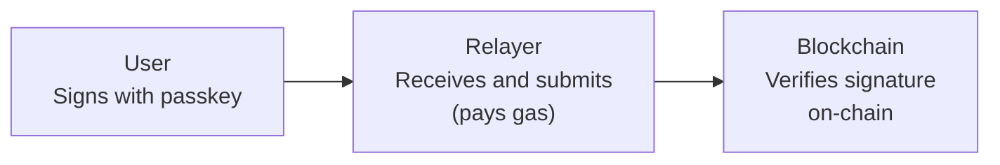

# Gasless Transactions

Veridex enables truly gasless transactions — users never need to hold ETH or other gas tokens.

## How It Works



1. User signs a payload with their passkey
2. Relayer receives the signed payload
3. Relayer submits the transaction and pays gas
4. Contract verifies the passkey signature on-chain

## Basic Usage

```typescript
import { createSDK } from '@veridex/sdk';
import { ethers } from 'ethers';

const sdk = createSDK('base', {
  network: 'testnet',
  relayerUrl: 'https://relayer.veridex.network', // Veridex relayer
});

await sdk.passkey.login();

// Gasless cross-chain bridge via relayer
const result = await sdk.bridgeViaRelayer(
  {
    sourceChain: 10004,       // Base Sepolia
    destinationChain: 10005,  // Optimism Sepolia
    token: '0x036CbD53842c5426634e7929541eC2318f3dCF7e',
    recipient: sdk.getVaultAddress(),
    amount: ethers.parseUnits('100', 6),
  },
  (progress) => console.log(progress.message)
);

console.log('Gasless bridge complete:', result.transactionHash);
```

## Relayer Configuration

### Use Veridex Relayer

```typescript
const sdk = createSDK('base', {
  network: 'testnet',
  relayerUrl: 'https://relayer.veridex.network',
});
```

### Run Your Own Relayer

```typescript
// Point to your self-hosted relayer
const sdk = createSDK('base', {
  network: 'testnet',
  relayerUrl: 'http://localhost:3001',
});
```

See [Relayer Setup](/api-reference/relayer) for self-hosting instructions.

## Sponsored Vault Creation

New vaults can be created gaslessly via the `GasSponsor`:

```typescript
// User has no ETH, but can still create a vault
const result = await sdk.sponsor.createVault(10005, credential);

console.log('Vault created on Optimism:', result.vaultAddress);
```

For integrators who want to sponsor vault creation for their users, pass a `sponsorPrivateKey` or `integratorSponsorKey` in the SDK config:

```typescript
const sdk = createSDK('base', {
  network: 'testnet',
  relayerUrl: 'https://relayer.veridex.network',
  sponsorPrivateKey: process.env.SPONSOR_KEY,
});
```

## Fee Model

While users don't pay gas, the relayer does. Relayer economics:

| Model | Description |
|-------|-------------|
| **Sponsored** | Relayer absorbs gas costs (promotional/enterprise) |
| **Protocol Fee** | Small fee deducted from transfer amount |
| **Subscription** | User/app pays monthly for gasless access |

### Check Bridge Fees

```typescript
const fees = await sdk.getBridgeFees({
  sourceChain: 10004,
  destinationChain: 10005,
  token: '0x036CbD53842c5426634e7929541eC2318f3dCF7e',
  recipient: sdk.getVaultAddress(),
  amount: 100000000n,
});

console.log('Source gas:', fees.sourceGas);
console.log('Message fee:', fees.messageFee);
console.log('Relayer fee:', fees.relayerFee);
console.log('Total:', fees.formattedTotal, fees.currency);
```

## Non-Relayer Fallback

If you want direct on-chain transactions (user pays gas):

```typescript
import { ethers } from 'ethers';

// Connect user's wallet for gas
const provider = new ethers.BrowserProvider(window.ethereum);
const signer = await provider.getSigner();

const sdk = createSDK('base', { network: 'testnet' });

// Prepare and execute directly (user pays gas)
const prepared = await sdk.prepareTransfer({
  targetChain: 10004,
  token: '0x036CbD53842c5426634e7929541eC2318f3dCF7e',
  recipient: '0x...',
  amount: ethers.parseUnits('100', 6),
});

const result = await sdk.transfer(prepared.params, signer);
```

## Stacks: Native Sponsored Transactions

Stacks has **native sponsored transactions** — the relayer can pay STX gas fees at the protocol level:

```typescript
const sdk = createSDK('stacks', {
  network: 'testnet',
  relayerUrl: 'https://relayer.veridex.network',
});

// The relayer automatically sponsors Stacks transactions
// Users never need to hold STX for gas
```

Stacks sponsorship limits:

| Limit | Value |
|-------|-------|
| Per-identity rate | 50 tx/hour |
| Per-tx fee cap | 0.5 STX |
| Hourly budget | 50 STX |

## Agent SDK: Gasless Payments

The Agent SDK handles gasless operations automatically:

```typescript
import { createAgentWallet } from '@veridex/agentic-payments';

const agent = await createAgentWallet({
  masterCredential: { /* ... */ },
  session: { dailyLimitUSD: 50, expiryHours: 24 },
  relayerUrl: 'https://relayer.veridex.network',
});

// All agent payments are gasless via the relayer
const receipt = await agent.pay({
  chain: 10004,
  token: 'USDC',
  amount: '1000000',
  recipient: '0x...',
});

// x402 payments are also gasless
const response = await agent.fetch('https://paid-api.example.com/data');
```

## React Integration

```tsx
import { useState } from 'react';
import { createSDK } from '@veridex/sdk';
import { ethers } from 'ethers';

const sdk = createSDK('base', {
  network: 'testnet',
  relayerUrl: 'https://relayer.veridex.network',
});

export function GaslessBridge() {
  const [targetChain, setTargetChain] = useState('10005');
  const [amount, setAmount] = useState('');
  const [loading, setLoading] = useState(false);
  const [progress, setProgress] = useState<string | null>(null);

  const handleBridge = async () => {
    setLoading(true);
    try {
      const result = await sdk.bridgeViaRelayer(
        {
          sourceChain: 10004,
          destinationChain: parseInt(targetChain),
          token: '0x036CbD53842c5426634e7929541eC2318f3dCF7e',
          recipient: sdk.getVaultAddress(),
          amount: ethers.parseUnits(amount, 6),
        },
        (p) => setProgress(`Step ${p.step}: ${p.message}`)
      );
      setProgress(`Done! Tx: ${result.transactionHash}`);
    } catch (error: any) {
      setProgress(`Error: ${error.message}`);
    }
    setLoading(false);
  };

  return (
    <div className="space-y-4">
      <div className="bg-blue-50 p-4 rounded-lg">
        <p className="text-blue-800 font-medium">Gasless Bridge</p>
        <p className="text-blue-600 text-sm">
          You don't need ETH — the relayer pays gas fees
        </p>
      </div>

      <select
        value={targetChain}
        onChange={(e) => setTargetChain(e.target.value)}
        className="block w-full rounded-md border p-2"
      >
        <option value="10005">Optimism Sepolia</option>
        <option value="10003">Arbitrum Sepolia</option>
        <option value="50003">Stacks Testnet</option>
      </select>

      <input
        type="number"
        value={amount}
        onChange={(e) => setAmount(e.target.value)}
        placeholder="Amount (USDC)"
        className="block w-full rounded-md border p-2"
      />

      <button
        onClick={handleBridge}
        disabled={loading}
        className="w-full bg-green-600 text-white py-2 rounded-lg"
      >
        {loading ? 'Bridging...' : 'Bridge (Gasless)'}
      </button>

      {progress && <p className="text-sm text-gray-600">{progress}</p>}
    </div>
  );
}
```

## Relayer Health Check

Check relayer status via the REST API:

```typescript
// Direct health check via fetch
const response = await fetch('https://relayer.veridex.network/health');
const health = await response.json();

console.log('Status:', health.status);
console.log('Chains:', health.chains);
```

See [Relayer API Reference](/api-reference/relayer) for all endpoints.

## Error Handling

```typescript
try {
  await sdk.bridgeViaRelayer(params, onProgress);
} catch (error: any) {
  if (error.message?.includes('relayer')) {
    // Fallback to direct transaction
    console.log('Relayer unavailable, user needs gas');
    const prepared = await sdk.prepareBridge(params);
    const result = await sdk.executeBridge(prepared, signer);
  } else if (error.message?.includes('rate')) {
    console.log('Rate limited, try again later');
  } else {
    console.error('Bridge failed:', error);
  }
}
```

## Benefits

| Benefit | Description |
|---------|-------------|
| **Zero gas UX** | Users never see "insufficient ETH" errors |
| **Lower friction** | No need to acquire gas tokens first |
| **Cross-chain ready** | Gasless on all supported chains |
| **Enterprise friendly** | Predictable costs for sponsors |

## Next Steps

<Cards>
  <Card title="Agent Payments" href="/guides/agent-payments">
    Gasless autonomous agent payments
  </Card>
  <Card title="Relayer API" href="/api-reference/relayer">
    Self-host your own relayer
  </Card>
  <Card title="Stacks" href="/chains/stacks">
    Native sponsored transactions on Stacks
  </Card>
</Cards>
