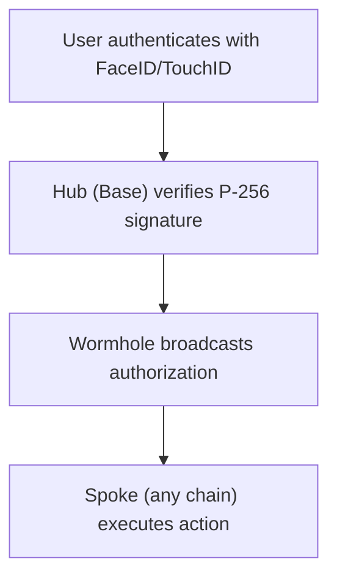

# Veridex Protocol

**One passkey. Any chain. Fully self-custodial.**

Veridex is a cross-chain passkey authentication protocol that lets users control assets on any blockchain with FaceID/TouchID — no seed phrases, no wallet apps, no chain switching. It also provides an **Agent SDK** for autonomous AI agent payments, on-chain identity (ERC-8004), and reputation-gated commerce.

## Two Packages, One Protocol

| Package | Purpose | Install |
|---------|---------|---------|
| **`@veridex/sdk`** | Core SDK — passkey wallets, vaults, sessions, cross-chain transfers, ERC-8004 utilities | `npm install @veridex/sdk` |
| **`@veridex/agentic-payments`** | Agent SDK — autonomous payments, on-chain identity, reputation, trust gates, discovery, MCP tools | `npm install @veridex/agentic-payments` |

## Why Veridex?

| Feature | Traditional Wallets | MPC/Custodial | Veridex |
|---------|---------------------|---------------|---------|
| **Login** | Seed phrase | Social/email | FaceID only |
| **Custody** | Self-custody | Custodial | **Fully self-custodial** |
| **Cross-chain** | Manual bridging | Limited | **Native multi-chain** |
| **Recovery** | Seed phrase | Via provider | **On-chain social recovery** |
| **AI Agents** | Not supported | Custodial keys | **Session keys + spending limits** |
| **Agent Identity** | None | None | **ERC-8004 on-chain identity + reputation** |

## Quick Links

<Cards>
  <Card title="Quick Start" href="/getting-started/quick-start">
    Integrate Veridex in 5 minutes
  </Card>
  <Card title="SDK Reference" href="/api-reference/sdk">
    Core SDK API documentation
  </Card>
  <Card title="Agent SDK Reference" href="/api-reference/agent-sdk">
    Agent SDK for autonomous payments
  </Card>
  <Card title="Agent Identity" href="/guides/agent-identity">
    ERC-8004 identity, reputation, and discovery
  </Card>
</Cards>

## Supported Chains

| Chain | Type | Status |
|-------|------|--------|
| Base | Hub (EVM) | ✅ Live |
| Optimism | Spoke (EVM) | ✅ Live |
| Arbitrum | Spoke (EVM) | ✅ Live |
| Solana | Spoke | ✅ Live |
| Aptos | Spoke | ✅ Live |
| Sui | Spoke | ✅ Live |
| Starknet | Spoke | ✅ Live |
| Stacks | Spoke | ✅ Live |
| Monad | Spoke (EVM) | ✅ Live |

## How It Works



Users get the **same deterministic vault address** across all EVM chains, derived from their passkey.

## Core SDK — Quick Example

```typescript
import { createSDK } from '@veridex/sdk';

// Initialize with testnet (default)
const sdk = createSDK('base', {
  network: 'testnet',
  relayerUrl: 'https://relayer.veridex.network',
});

// Register a passkey (prompts biometric)
const credential = await sdk.passkey.register('alice', 'My Wallet');

// Get your deterministic vault address (same on all EVM chains)
const vaultAddress = sdk.getVaultAddress();
console.log('Vault:', vaultAddress);

// Check spending limits
const limits = await sdk.getSpendingLimits();
console.log('Daily remaining:', limits.dailyRemaining);

// Prepare and execute a transfer
const prepared = await sdk.prepareTransfer({
  targetChain: 10004,  // Base Sepolia
  token: '0x036CbD53842c5426634e7929541eC2318f3dCF7e', // USDC
  recipient: '0x742d35Cc6634C0532925a3b844Bc9e7595f5A234',
  amount: 1000000n,    // 1 USDC
});

// Get human-readable summary before signing
const summary = await sdk.getTransactionSummary(prepared);
console.log(summary.title, summary.description);
```

## Agent SDK — Quick Example

```typescript
import { createAgentWallet } from '@veridex/agentic-payments';

// Create an autonomous agent wallet with on-chain identity
const agent = await createAgentWallet({
  masterCredential: {
    credentialId: 'passkey-credential-id',
    publicKeyX: 0n,
    publicKeyY: 0n,
    keyHash: '0x...',
  },
  session: {
    dailyLimitUSD: 50,
    perTransactionLimitUSD: 10,
    expiryHours: 24,
    allowedChains: [10004], // Base Sepolia
  },
  erc8004: {
    enabled: true,
    testnet: true,
    minReputationScore: 30, // only pay merchants with 30+ reputation
  },
});

// Register on-chain identity (ERC-721 NFT)
const { agentId } = await agent.register({
  name: 'My Data Agent',
  description: 'Autonomous data analyst',
  services: [{ name: 'analysis', endpoint: 'https://my-agent.com/api' }],
});

// Fetch with auto-payment + reputation check + auto-feedback
const response = await agent.fetch('https://paid-api.example.com/data');
const data = await response.json();

// Discover other agents by capability
const agents = await agent.discover({ category: 'sentiment' });

// Check a merchant's reputation before subscribing
const trust = await agent.checkMerchantTrust('https://data-provider.com');
console.log(`Reputation: ${trust.score}/100`);
```

## Resources

- [GitHub Repository](https://github.com/Veridex-Protocol/)
- [Demo Video](https://youtu.be/CgSvFqrVGAw)
- [Discord Community](https://discord.gg/veridex)
- [Telegram Community](https://t.me/+1b16cbymIYI4OTVk)
- [Twitter @VeridexLabs](https://x.com/VeridexLabs)