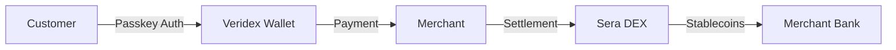

# Sera Protocol Integration

Build payment solutions with Veridex authentication and Sera DEX settlement.

<Info>
Sera Protocol is a decentralized exchange with an orderbook model, enabling atomic on-chain stablecoin settlement. Combined with Veridex passkey authentication, it provides a complete payment gateway solution.
</Info>

## Overview



## Prerequisites

<CardGroup cols={2}>
  <Card title="Veridex SDK" icon="key" href="/getting-started/installation">
    Install and configure the Veridex SDK
  </Card>
  <Card title="Ethereum Sepolia" icon="ethereum" href="/chains/ethereum">
    Access to Sepolia testnet RPC
  </Card>
</CardGroup>

## Quick Start

### 1. Install Dependencies

<CodeGroup>
```bash bun
bun add @veridex/sdk ethers axios
```

```bash npm
npm install @veridex/sdk ethers axios
```
</CodeGroup>

### 2. Configure Environment

```env .env
# Ethereum Sepolia RPC
NEXT_PUBLIC_RPC_URL=https://eth-sepolia.g.alchemy.com/v2/YOUR_KEY

# Sera GraphQL API
NEXT_PUBLIC_GRAPHQL_URL=https://api.goldsky.com/api/public/project_cmicv6kkbhyto01u3agb155hg/subgraphs/sera-pro/1.0.9/gn

# Settlement wallet (keep secure!)
SETTLEMENT_WALLET_KEY=your-private-key
```

### 3. Initialize Services

```typescript
import { createSDK } from '@veridex/sdk';
import { SeraService } from './sera-service';

// Veridex for authentication
const veridex = createSDK('ethereum', { network: 'testnet' });

// Sera for settlement
const sera = new SeraService(process.env.NEXT_PUBLIC_RPC_URL!);
```

## Contract Addresses

<Tabs>
  <Tab title="Sepolia Testnet">
    | Contract | Address |
    |----------|---------|
    | Sera Router | `0x82bfe1b31b6c1c3d201a0256416a18d93331d99e` |
    | Market Factory | `0xe54648526027e236604f0d91413a6aad3a80c01e` |
    | Order Canceler | `0x53ad1ffcd7afb1b14c5f18be8f256606efb11b1b` |
    | Veridex VaultFactory | `0x07F608AFf6d63b68029488b726d895c4Bb593038` |
    | Veridex VaultImpl | `0xD66153fccFB6731fB6c4944FbD607ba86A76a1f6` |
  </Tab>
  <Tab title="Mainnet">
    <Warning>Mainnet deployment coming soon</Warning>
  </Tab>
</Tabs>

## Payment Flow

<Steps>
  <Step title="Customer Authenticates">
    Customer connects using Veridex passkey or WalletConnect
    ```typescript
    // Option 1: Passkey (recommended)
    await veridex.passkey.authenticate();
    
    // Option 2: WalletConnect
    const { address } = await connectWalletConnect();
    ```
  </Step>
  
  <Step title="Prepare Payment">
    Create a payment intent and get signing challenge
    ```typescript
    const { transferId, challenge } = await veridex.prepareTransfer({
      recipient: merchantAddress,
      amount: BigInt('99990000'), // 99.99 USDC (6 decimals)
      token: USDC_ADDRESS,
    });
    ```
  </Step>
  
  <Step title="Customer Signs">
    Biometric prompt for payment authorization
    ```typescript
    const signature = await veridex.passkey.sign(challenge);
    ```
  </Step>
  
  <Step title="Execute Payment">
    Submit signed transaction
    ```typescript
    const { txHash } = await veridex.executeTransfer(prepared, signature);
    ```
  </Step>
  
  <Step title="Settlement via Sera">
    Convert received payment to merchant's preferred currency
    ```typescript
    // Place limit order on Sera DEX
    await sera.placeLimitBid(signer, {
      market: usdcEurcMarket,
      priceIndex: currentPrice,
      rawAmount: amount,
    });
    
    // Poll for fill
    const orders = await sera.getOrderStatus(address, market);
    
    // Claim when filled
    await sera.claimProceeds(signer, orders);
    ```
  </Step>
</Steps>

## Sera Service Implementation

<Accordion title="Complete SeraService Class">
```typescript sera-service.ts
import { ethers } from 'ethers';
import axios from 'axios';

const SERA_CONFIG = {
  chainId: 11155111,
  routerAddress: '0x82bfe1b31b6c1c3d201a0256416a18d93331d99e',
  graphqlUrl: 'https://api.goldsky.com/api/public/project_cmicv6kkbhyto01u3agb155hg/subgraphs/sera-pro/1.0.9/gn',
};

const ROUTER_ABI = [
  'function limitBid((address market, uint64 deadline, uint32 claimBounty, address user, uint16 priceIndex, uint64 rawAmount, bool postOnly, bool useNative, uint256 baseAmount)) returns (uint256)',
  'function claim(uint64 deadline, (address market, (bool isBid, uint16 priceIndex, uint256 orderIndex)[] orderKeys)[])',
];

export class SeraService {
  private router: ethers.Contract;

  constructor(rpcUrl: string) {
    const provider = new ethers.JsonRpcProvider(rpcUrl);
    this.router = new ethers.Contract(
      SERA_CONFIG.routerAddress,
      ROUTER_ABI,
      provider
    );
  }

  async getMarkets() {
    const response = await axios.post(SERA_CONFIG.graphqlUrl, {
      query: `
        query {
          markets(first: 100) {
            id
            quoteToken { symbol decimals }
            baseToken { symbol decimals }
            minPrice tickSpace quoteUnit
            latestPrice latestPriceIndex
          }
        }
      `,
    });
    return response.data.data.markets;
  }

  async placeLimitBid(signer: ethers.Signer, params: {
    market: string;
    priceIndex: number;
    rawAmount: bigint;
  }) {
    const routerWithSigner = this.router.connect(signer);
    return routerWithSigner.limitBid({
      market: params.market,
      deadline: Math.floor(Date.now() / 1000) + 3600,
      claimBounty: 0,
      user: await signer.getAddress(),
      priceIndex: params.priceIndex,
      rawAmount: params.rawAmount,
      postOnly: false,
      useNative: false,
      baseAmount: 0n,
    });
  }

  async getOrderStatus(user: string, market: string) {
    const response = await axios.post(SERA_CONFIG.graphqlUrl, {
      query: `
        query($user: String!, $market: String!) {
          openOrders(where: { user: $user, market: $market }) {
            id nftId priceIndex rawAmount status claimableAmount
          }
        }
      `,
      variables: { user: user.toLowerCase(), market: market.toLowerCase() },
    });
    return response.data.data.openOrders;
  }

  async claimProceeds(signer: ethers.Signer, paramsList: any[]) {
    const routerWithSigner = this.router.connect(signer);
    return routerWithSigner.claim(
      Math.floor(Date.now() / 1000) + 3600,
      paramsList
    );
  }
}
```
</Accordion>

## Price Conversion

Sera uses indexed pricing:

```typescript
// Price formula
price = minPrice + (tickSpace × priceIndex)

// Example: Convert $1.05 to price index
const priceIndex = (price - minPrice) / tickSpace;

// Amount conversion
quoteAmount = rawAmount × quoteUnit
rawAmount = quoteAmount / quoteUnit
```

<Tip>
Always fetch current market parameters from GraphQL before placing orders to ensure accurate price indices.
</Tip>

## Security Best Practices

<AccordionGroup>
  <Accordion title="Token Approvals" icon="shield-check">
    Always approve exact amounts, never unlimited:
    ```typescript
    await token.approve(ROUTER_ADDRESS, exactAmount);
    ```
  </Accordion>
  
  <Accordion title="Deadline Management" icon="clock">
    Use reasonable deadlines to prevent stale orders:
    ```typescript
    const deadline = Math.floor(Date.now() / 1000) + 3600; // 1 hour
    ```
  </Accordion>
  
  <Accordion title="Key Management" icon="key">
    Never store private keys in code. Use:
    - Environment variables (development)
    - Hardware security modules (production)
    - Cloud secret managers (AWS Secrets, GCP Secret Manager)
  </Accordion>
</AccordionGroup>

## Error Handling

```typescript
try {
  await sera.placeLimitBid(signer, params);
} catch (error) {
  if (error.message.includes('insufficient allowance')) {
    // Approve tokens first
    await token.approve(ROUTER_ADDRESS, amount);
    await sera.placeLimitBid(signer, params);
  } else if (error.message.includes('deadline')) {
    // Retry with fresh deadline
    params.deadline = Math.floor(Date.now() / 1000) + 3600;
  } else {
    throw error;
  }
}
```

## Example: Complete Payment Gateway

<Card title="Sera Dashboard" icon="browser" href="https://github.com/veridex-protocol/sera">
  Full-featured payment dashboard with invoice management, payment links, and settlement tracking.
</Card>

```typescript
// Complete payment flow
async function processPayment(invoiceId: string) {
  const invoice = await db.invoice.findUnique({ where: { id: invoiceId } });
  
  // 1. Customer pays via Veridex
  const { txHash } = await executePayment(invoice.amount);
  
  // 2. Update invoice
  await db.invoice.update({
    where: { id: invoiceId },
    data: { status: 'paid', paymentTxHash: txHash },
  });
  
  // 3. Settle via Sera (if currency conversion needed)
  if (invoice.settlementCurrency !== invoice.paymentCurrency) {
    const settlement = await settleViaSera(
      invoice.amount,
      invoice.paymentCurrency,
      invoice.settlementCurrency
    );
    
    await db.invoice.update({
      where: { id: invoiceId },
      data: { 
        status: 'settled',
        settlementTxHash: settlement.txHash,
      },
    });
  }
  
  // 4. Send webhook
  await sendWebhook(invoice.merchantId, 'invoice.settled', invoice);
}
```

## Related Guides

<CardGroup cols={3}>
  <Card title="Payment Gateway" icon="credit-card" href="/integrations/payment-gateway">
    Build a complete payment gateway
  </Card>
  <Card title="React Integration" icon="react" href="/integrations/react">
    React hooks and components
  </Card>
  <Card title="Next.js Integration" icon="n" href="/integrations/nextjs">
    Full-stack Next.js integration
  </Card>
</CardGroup>
