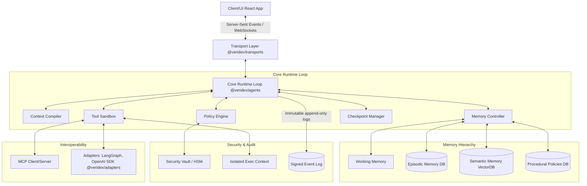
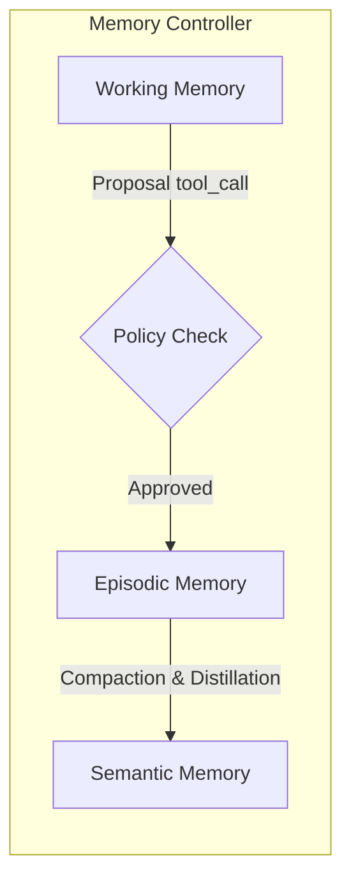
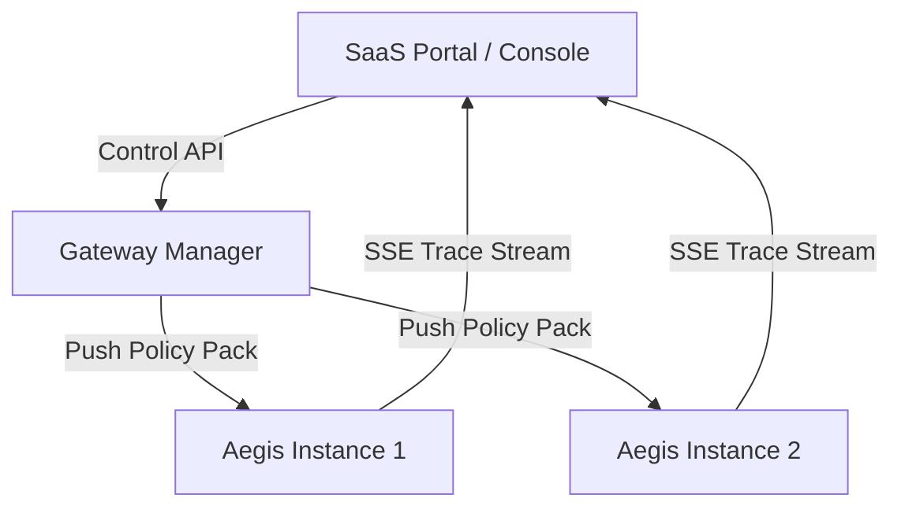

import { Steps, Callout, CodeGroup, Tip, Warning, Danger } from "../../components/mdx"

# The Perfect Agent Framework (Veridex Agents)
## Technical Specification & Architecture

This document defines the complete technical specification for **Veridex Agents** (`@veridex/agents` and companion libraries): a next-generation TypeScript-based modular runtime and library suite designed to deliver complete security, robust production mechanics, and long-context cognitive continuity without drift or decay.

---

## 1. High-Level Architecture

The Veridex Agent system is partitioned into cleanly decoupled, single-responsibility modules. It treats models, tools, policies, transports, and memories as strictly typed, independent primitives.



### Package breakdown and public surface:

1. **`@veridex/agents`**: Contains the core runtime loop (`Veridex Agents`), the `ContextCompiler`, the stateful `MemoryManager`, and the foundational `PolicyEngine`.
2. **`@veridex/security`**: Enforces cryptography-based schema integrity, isolated tool execution sandboxes, and secure credential vault ingestion.
3. **`@veridex/adapters`**: Bidirectional migration bridges for LangChain, LangGraph, OpenAI Assistants SDK, and PydanticAI.
4. **`@veridex/react`**: React context providers and reactive hooks (`useRun`, `useApprovals`, `useTrace`, `useMemory`) for real-time frontend monitoring.
5. **`@veridex/control-plane`**: Enterprise SaaS dashboard endpoints, tenant budget governance, multi-step escalation chains, and telemetry logging.

---

## 2. Core Runtime Loop

The life cycle of `agent.run(input)` is entirely deterministic, event-sourced, and budget-bound. Every loop iteration represents a transition in a strictly governed state machine.

```mermaid
sequenceDiagram
    autonumber
    participant App as Application / Caller
    participant Runtime as Veridex Agents Loop
    participant Mem as Memory Controller
    participant Compiler as Context Compiler
    participant Policy as Policy Engine
    participant Sandbox as Tool Sandbox
    participant Model as LLM / Provider

    App->>Runtime: run(prompt)
    Runtime->>Runtime: Initialize Turn
    Runtime->>Mem: Fetch relevant Episodic & Semantic memories
    Runtime->>Compiler: Compile prompt within token budget (Ve)
    Compiler-->>Runtime: Compiled Prompt Context (tokens <= Ve)
    
    Loop Reasoning Turn
        Runtime->>Model: Generate Next Action
        Model-->>Runtime: Proposed Tool Call / Reply
        
        alt Model proposed Tool Call
            Runtime->>Policy: Evaluate ToolProposal against Rules
            alt Verdict is ALLOW
                Policy-->>Runtime: Allow
                Runtime->>Sandbox: Execute sandboxed tool with inputs
                Sandbox-->>Runtime: Cleaned JSON result & metadata
            alt Verdict is ESCALATE (e.g. Approval Required)
                Policy-->>Runtime: Suspend Required
                Runtime->>Runtime: Save Checkpoint (State, Memory, Trace Index)
                Runtime-->>App: Emit SUSPENDED (approval_requested)
            alt Verdict is DENY
                Policy-->>Runtime: Deny
                Runtime->>Runtime: Ingest block response into history
            end
        else Model responded with terminal output
            Runtime->>Mem: Propose distilled observations
            Mem->>Policy: Validate Memory Write Proposals
            Policy-->>Mem: Commit Allowed
            Mem->>Mem: Update Semantic/Episodic stores & anti-drift reconciliation
            Runtime->>Runtime: Save final Checkpoint
            Runtime-->>App: Return Terminal Outcome & Signed Evidence Bundle
        end
    end
```

### Core Execution Loop Signature
```typescript
export interface RunResult {
  runId: string;
  output: string;
  state: 'completed' | 'suspended' | 'failed';
  checkpointId?: string;
  evidenceBundle?: SignedEvidenceBundle;
  tokensUsed: number;
}

export class Veridex Agents {
  async run(prompt: string, options?: RunOptions): Promise<RunResult> {
    const runContext = this.initializeRun(prompt, options);
    this.emitEvent('run_started', { runId: runContext.id });

    try {
      while (runContext.hasMoreTurns()) {
        this.emitEvent('turn_started', { turnIndex: runContext.turnIndex });

        // 1. Compile Context using the Root Theorem
        const compiledContext = await this.contextCompiler.compile({
          history: runContext.history,
          workingMemory: runContext.memory.working,
          semanticQuery: prompt,
          maxTokens: this.effectiveContextWindow
        });

        // 2. Query LLM Provider
        const response = await this.modelProvider.generate(compiledContext);
        runContext.recordUsage(response.tokens);

        if (response.type === 'tool_call') {
          // 3. Propose and Evaluate Tool
          const proposal = this.createToolProposal(response.toolCalls);
          const policyVerdict = await this.policyEngine.evaluate(proposal, runContext);

          if (policyVerdict.verdict === 'deny') {
            runContext.recordSystemFeedback(`Policy Denied: ${policyVerdict.reason}`);
            continue;
          }

          if (policyVerdict.verdict === 'escalate') {
            const checkpointId = await this.checkpointManager.save(runContext);
            this.emitEvent('approval_requested', { checkpointId, approvalId: policyVerdict.approvalId });
            return { runId: runContext.id, output: '', state: 'suspended', checkpointId };
          }

          // 4. Safe Tool Execution in Sandbox
          const toolResult = await this.toolSandbox.execute(response.toolCalls, {
            runId: runContext.id,
            permissions: this.getToolPermissions(response.toolCalls.name)
          });

          runContext.recordToolOutput(response.toolCalls.id, toolResult);
        } else {
          // 5. Terminal response reached. Distill and evolve memories.
          await this.memoryController.evolve(runContext);
          const checkpointId = await this.checkpointManager.save(runContext);
          const evidenceBundle = await this.evidenceBundler.seal(runContext);

          return {
            runId: runContext.id,
            output: response.text,
            state: 'completed',
            checkpointId,
            evidenceBundle,
            tokensUsed: runContext.totalTokens
          };
        }
      }
    } catch (error: any) {
      this.emitEvent('run_failed', { runId: runContext.id, error: error.message });
      throw error;
    }
  }
}
```

---

## 3. Context Compiler & Token Budget

Based on the **Root Theorem of Context Engineering** (Schick, 2026), context is treated as a lossy channel. Degradation does not occur linearly; output quality hit a catastrophic cliff well before the raw context window limit is reached. The compiler strictly enforces an effective window $V_e$ (typically 50-70% of raw model limit) and optimizes the prompt compilation to maximize the **signal-to-token ratio**:

$$\max_{C} \Phi = \frac{S(C)}{T(C)}$$

```typescript
export interface CompileOptions {
  history: ChatMessage[];
  workingMemory: Record<string, string>;
  semanticQuery: string;
  maxTokens: number; // Ve Limit
}

export class ContextCompiler {
  async compile(options: CompileOptions): Promise<CompiledPrompt> {
    const { history, workingMemory, semanticQuery, maxTokens } = options;
    
    // Allocate proportional budgets
    const budget = {
      systemInstructions: Math.floor(maxTokens * 0.15),
      memoryBlocks: Math.floor(maxTokens * 0.25),
      toolDefinitions: Math.floor(maxTokens * 0.15),
      history: Math.floor(maxTokens * 0.35),
      generationHeadroom: Math.floor(maxTokens * 0.10)
    };

    // 1. Pull relevant semantic and episodic memories
    const relevantMemories = await this.memoryController.retrieve(semanticQuery, {
      maxTokens: budget.memoryBlocks,
      rankingStrategy: 'signal_to_token_density' // ranking by info-entropy density
    });

    // 2. Compile dynamic tool definitions with schema signatures
    const toolDefinitions = this.compilerToolSchemas(budget.toolDefinitions);

    // 3. Process and compress chat history
    let compiledHistory = history;
    const historyTokens = this.tokenCounter.count(history);
    
    if (historyTokens > budget.history) {
      // Dynamic compression: Summarize old turns, compress tool outputs, shed intermediate steps
      compiledHistory = await this.compressHistory(history, budget.history);
    }

    return {
      system: this.systemPromptTemplate,
      memories: relevantMemories,
      tools: toolDefinitions,
      history: compiledHistory,
      headroom: budget.generationHeadroom
    };
  }

  private async compressHistory(history: ChatMessage[], targetBudget: number): Promise<ChatMessage[]> {
    // Preserve recent 3 turns entirely; summarize older blocks
    const tailTurns = history.slice(-6);
    const headTurns = history.slice(0, -6);

    const distilledHead = await this.summarizeBlock(headTurns);
    return [
      { role: 'system', content: `[HISTORICAL SUMMARY]: ${distilledHead}` },
      ...tailTurns
    ];
  }
}
```

---

## 4. Memory Architecture

Veridex Agents features a stateful, hierarchical memory module that avoids the cost bloat of full transcript replays, using structured registers and retroactive semantic linking.



### Memory Tiers
1. **Working Memory**: In-context scratchpad representing current session state. Discarded automatically at the end of the run unless elements are promoted.
2. **Episodic Memory**: Timestamped logs of multi-turn interactions. Queryable via hybrid lexical + vector search. Features automatic decay:
   $$Score = S_0 \cdot e^{-\lambda t}$$
3. **Semantic Memory**: High-level, stable factual database. Stores facts as discrete entities with confidence scores, version history, and provenance metadata.
4. **Procedural Memory**: System instructions, security policies, and tool utilization workflows.

### Memory Propose & Evolve API
When the agent discovers a new fact, it proposes a memory write by emitting a `propose_memory` tool call. This proposal must pass through the policy engine before being written.

```typescript
export interface MemoryRecord {
  id: string;
  content: string;
  type: 'semantic' | 'episodic';
  confidence: number; // 0.0 to 1.0
  provenance: {
    runId: string;
    turnIndex: number;
    timestamp: number;
  };
  tags: string[];
}

export class MemoryController {
  async proposeWrite(record: Omit<MemoryRecord, 'id' | 'provenance'>, context: RunContext): Promise<boolean> {
    const proposal: ProposedAction = {
      type: 'memory_write',
      record: {
        ...record,
        id: crypto.randomUUID(),
        provenance: { runId: context.id, turnIndex: context.turnIndex, timestamp: Date.now() }
      }
    };

    const policyResult = await this.policyEngine.evaluate(proposal, context);
    if (policyResult.verdict !== 'allow') {
      return false;
    }

    await this.commitWrite(proposal.record);
    await this.reconcileAndDeduplicate(proposal.record); // Anti-drift
    return true;
  }

  private async reconcileAndDeduplicate(newRecord: MemoryRecord): Promise<void> {
    // 1. Embedding search for semantically overlapping records
    const conflicts = await this.vectorStore.search(newRecord.content, { threshold: 0.85 });

    for (const item of conflicts) {
      if (this.detectConflict(newRecord, item)) {
        // Resolve conflict: choose higher confidence or prompt LLM for synthesis
        await this.resolveMemoryDrift(newRecord, item);
      } else {
        // Semantic linking (Zettelkasten style)
        await this.vectorStore.createLink(newRecord.id, item.id, 'semantic-association');
      }
    }
  }
}
```

---

## 5. Tool System & Poisoning Protections

Tool Poisoning Attacks (TPA) leverage malicious metadata injections to trigger unauthorized agent actions. Veridex Agents neutralizes this threat by treating tool descriptions, inputs, outputs, and environments as untrusted boundaries.

```typescript
import { z } from 'zod';

export type SafetyClass = 'read' | 'write' | 'network' | 'financial' | 'privileged';

export interface ToolContract<TIn extends z.ZodType, TOut> {
  name: string;
  description: string;
  schemaHash: string; // Cryptographic hash of the structural schema
  safetyClass: SafetyClass;
  inputSchema: TIn;
  outputSchema: z.ZodType<TOut>;
  idempotencyHint?: boolean;
  retryPolicy?: { maxRetries: number; backoffMs: number };
  execute: (input: z.infer<TIn>, context: ExecutionContext) => Promise<TOut>;
}

export function createTool<TIn extends z.ZodType, TOut>(
  contract: Omit<ToolContract<TIn, TOut>, 'schemaHash'>
): ToolContract<TIn, TOut> {
  const schemaHash = crypto
    .createHash('sha256')
    .update(contract.name + JSON.stringify(contract.inputSchema.description))
    .digest('hex');

  return { ...contract, schemaHash };
}
```

### Execution Sandbox Isolation
Tools are run in isolated, context-bound execution environments where runtime permissions are strictly validated.

```typescript
export class ToolSandbox {
  async execute<TIn extends z.ZodType, TOut>(
    tool: ToolContract<TIn, TOut>,
    rawInput: unknown,
    context: ExecutionContext
  ): Promise<TOut> {
    // 1. Verify schema hash has not been poisoned or tampered with
    const activeHash = this.computeHash(tool);
    if (activeHash !== tool.schemaHash) {
      throw new Error(`CRITICAL: Tool ${tool.name} schema verification failed. Schema modified dynamically.`);
    }

    // 2. Validate input constraints strictly
    const validatedInput = tool.inputSchema.safeParse(rawInput);
    if (!validatedInput.success) {
      throw new Error(`Input validation error: ${validatedInput.error.message}`);
    }

    // 3. Apply sandboxing context (chroot directories, network allowlists)
    const sandboxEnv = this.provisionEnvironment(tool.safetyClass, context);
    
    try {
      const output = await sandboxEnv.run(async () => {
        return await tool.execute(validatedInput.data, context);
      });

      // 4. Sanitize outputs to prevent downstream prompt injection
      return tool.outputSchema.parse(output);
    } catch (err: any) {
      return this.handleToolError(err, tool);
    }
  }
}
```

---

## 6. Policy Engine

The Policy Engine acts as a gatekeeper that intercepts all actions (tool proposals, memory updates, system handoffs) and evaluates them against declarative policy rules.

```typescript
export type Verdict = 'allow' | 'deny' | 'escalate';

export interface PolicyCheckResult {
  ruleId: string;
  ruleName: string;
  passed: boolean;
  verdict: Verdict;
  reason?: string;
  approvalId?: string;
}

export interface PolicyRule {
  id: string;
  name: string;
  evaluate: (proposal: ProposedAction, context: RunContext) => Promise<PolicyCheckResult>;
}

export class PolicyEngine {
  private rules: PolicyRule[] = [];

  registerRule(rule: PolicyRule) {
    this.rules.push(rule);
    this.rules.sort((a, b) => this.getPriority(b) - this.getPriority(a));
  }

  async evaluate(proposal: ProposedAction, context: RunContext): Promise<PolicyCheckResult> {
    for (const rule of this.rules) {
      const result = await rule.evaluate(proposal, context);
      if (result.verdict === 'deny' || result.verdict === 'escalate') {
        return result; // Early exit on restriction
      }
    }
    return { ruleId: 'system.allow', ruleName: 'Default Allow', passed: true, verdict: 'allow' };
  }
}
```

---

## 7. Approval & Human-in-the-Loop

When a policy rule returns an `escalate` verdict, the runtime cleanly suspends the execution thread, generates an immutable checkpoint snapshot, and registers an approval request.

```typescript
export interface ApprovalRequest {
  id: string;
  runId: string;
  checkpointId: string;
  requiredApprovals: number;
  approvers: string[];
  status: 'pending' | 'approved' | 'rejected';
  createdAt: number;
  timeoutAt: number;
}

export class ApprovalManager {
  async suspendRun(runContext: RunContext, verdict: PolicyCheckResult): Promise<ApprovalRequest> {
    const checkpointId = await this.checkpointManager.createSnapshot(runContext);
    
    const request: ApprovalRequest = {
      id: crypto.randomUUID(),
      runId: runContext.id,
      checkpointId,
      requiredApprovals: verdict.ruleId.includes('dual') ? 2 : 1,
      approvers: [],
      status: 'pending',
      createdAt: Date.now(),
      timeoutAt: Date.now() + 3600000 // 1 hour timeout
    };

    await this.db.storeApprovalRequest(request);
    this.eventBus.emit('approval_requested', request);
    return request;
  }

  async resolveApproval(requestId: string, approver: string, approved: boolean): Promise<RunResult> {
    const request = await this.db.getApprovalRequest(requestId);
    if (request.status !== 'pending' || Date.now() > request.timeoutAt) {
      throw new Error('Approval request is not pending or has expired');
    }

    if (!approved) {
      request.status = 'rejected';
      await this.db.storeApprovalRequest(request);
      return this.runtime.terminateSuspended(request.checkpointId, 'Approval rejected');
    }

    request.approvers.push(approver);
    if (request.approvers.length >= request.requiredApprovals) {
      request.status = 'approved';
      await this.db.storeApprovalRequest(request);
      
      // Resume loop with approved context
      return this.runtime.resumeFromCheckpoint(request.checkpointId, {
        approvals: request.approvers
      });
    }

    await this.db.storeApprovalRequest(request);
    return { runId: request.runId, output: '', state: 'suspended' };
  }
}
```

---

## 8. Checkpoints & Durability

Checkpoints are stored as immutable snapshots, enabling runs to resume seamlessly across processes, servers, or serverless restarts.

```typescript
export interface Checkpoint {
  id: string;
  runId: string;
  turnIndex: number;
  history: ChatMessage[];
  memoryDelta: {
    working: Record<string, string>;
    episodicDiff: string[];
  };
  eventLogIndex: number;
  timestamp: number;
}

export interface CheckpointBackend {
  save(checkpoint: Checkpoint): Promise<void>;
  load(id: string): Promise<Checkpoint>;
}

// Checkpoint implementation leverages Postgres JSONB storage or direct File IO
export class PostgresCheckpointBackend implements CheckpointBackend {
  async save(checkpoint: Checkpoint): Promise<void> {
    await this.db.query(
      `INSERT INTO aegis_checkpoints (id, run_id, state) VALUES ($1, $2, $3)`,
      [checkpoint.id, checkpoint.runId, JSON.stringify(checkpoint)]
    );
  }
  async load(id: string): Promise<Checkpoint> {
    const res = await this.db.query(`SELECT state FROM aegis_checkpoints WHERE id = $1`, [id]);
    return JSON.parse(res.rows[0].state);
  }
}
```

---

## 9. Observability & Eventing

Every state transition within the Veridex Agents runtime publishes a typed, immutable event to an internal event bus.

```typescript
export interface TraceEvent {
  eventId: string;
  runId: string;
  turnIndex: number;
  type: 'run_started' | 'tool_proposed' | 'tool_executed' | 'policy_decision' | 'memory_written';
  timestamp: number;
  payload: Record<string, any>;
  previousEventHash: string; // Creates a cryptographic chain for tamper-detection
}

export class AuditLog {
  private lastHash: string = '0';

  async append(runId: string, type: TraceEvent['type'], payload: Record<string, any>): Promise<TraceEvent> {
    const event: TraceEvent = {
      eventId: crypto.randomUUID(),
      runId,
      turnIndex: this.currentTurn,
      type,
      timestamp: Date.now(),
      payload,
      previousEventHash: this.lastHash
    };

    const canonicalBytes = Buffer.from(JSON.stringify(event));
    this.lastHash = crypto.createHash('sha256').update(canonicalBytes).digest('hex');
    await this.storage.write(event);
    return event;
  }
}
```

---

## 10. Security Architecture

Veridex Agents treats the host environment, models, and tools as separate security zones.

| Threat | Vulnerability Vector | Aegis Mitigation |
|---|---|---|
| **Tool Poisoning (TPA)** | Hijacking models via descriptions or tool JSON schemas. | **Schema-signing & hash validation**: Any schema change is blocked runtime. Inputs and outputs pass through separate parsing filters. |
| **Prompt Injection** | Exploiting untrusted file contents to trigger actions. | **Content boundaries & system-data isolation**: Raw inputs are injected only within specific payload block parameters. |
| **Command Injection** | Unsanitized string inputs forwarded to shell execution. | **Zod-validation & sandboxed isolation**: No shell executions are executed from general tools; absolute limits are applied. |
| **Confused Deputy** | Exploiting overly broad agent permissions to read/write directories. | **chroot path-jailing & security allowlists**: File system tools are jailed using path-prefixes and directories. Network access requires domain allowlists. |

---

## 11. Transports & Interoperability

Veridex Agents is transport-agnostic and provides native integration with the Model Context Protocol (MCP) and multi-agent communication frameworks.

### First-Class Model Context Protocol (MCP) Bridge
Expose tools to any MCP host securely, or register remote MCP tools inside your Aegis runtime:

```typescript
import { MCPServer } from '@veridex/agents';

export function runMcpServer(agent: Veridex Agents) {
  const mcp = new MCPServer({
    name: 'Aegis Treasury Tools',
    version: '1.0.0',
    allowedDomains: ['*']
  });

  // Map Aegis tools to MCP protocol schemas
  mcp.registerTools(agent.getTools());
  mcp.start(3001);
}
```

---

## 12. Developer Experience

We believe that complex code leads to security gaps. Veridex Agents offers an extremely clean, minimal, and fully typed developer interface.

```typescript
import { createVeridex Agents, tool } from '@veridex/agents';
import { z } from 'zod';

const myAgent = createVeridex Agents({
  name: 'Corporate Assistant',
  model: 'gpt-4o',
  instructions: 'Process transfers and payments.',
  tools: [
    tool({
      name: 'send_payment',
      description: 'Transfer corporate funds.',
      input: z.object({ to: z.string(), amount: z.number() }),
      safetyClass: 'financial',
      execute: async ({ to, amount }) => {
        return { success: true, tx: '0x123' };
      }
    })
  ],
  policies: [
    { rule: 'maxDailyLimit', params: { limitUSD: 1000 } }
  ]
});
```

---

## 13. Testing & Evaluation Harness

The `@veridex/agents/testing` harness supports stateful, multi-turn regression verification.

```typescript
// tests/treasury.test.ts
import { AegisTestRunner, goldenTraceMatcher } from '@veridex/agents/testing';

describe('Treasury Evaluation Pipeline', () => {
  it('should suspend on values exceeding $10,000', async () => {
    const runner = new AegisTestRunner(myAgent);
    
    const result = await runner.executeTurn(
      'Please send $50,000 USD to Acme Suppliers.'
    );

    expect(result.state).toBe('suspended');
    expect(result.checkpointId).toBeDefined();

    // Verify golden-trace comparison (ensures reasoning trace is intact)
    expect(runner.getEventLog()).toMatchTrace(goldenTraceMatcher('treasury-suspension'));
  });
});
```

---

## 14. Control Plane & Enterprise Governance

The enterprise-grade control plane implements global fleet management, tenant-isolated configurations, dynamic policy updates, and compliance analytics.



---

## 15. Migration Path

Adopt Veridex Agents in your existing codebase progressively:

```typescript
// Wrap your legacy LangChain tool
import { convertLangChainTool } from '@veridex/adapters';

const legacyTool = new MyLegacyLangChainTool();
const aegisTool = convertLangChainTool(legacyTool, { safetyClass: 'write' });
```

---

## 16. End-to-End Scenario Walk-Through

### Scenario: High-Value Supplier Payout Process
In this scenario, a treasury agent checks its balance, initiates a payout of $50,000 to a supplier (Acme Suppliers), is suspended due to a $10,000 limit check, and completes the payout once dual-operators sign and approve.

```typescript
import { createVeridex Agents, createTreasuryKit } from '@veridex/agents';

// 1. Initialize the secure financial controls plugin
const kit = createTreasuryKit({
  appId: 'ops-suite-01',
  runId: 'invoice-cycle-2026',
  agentId: 'payout-bot',
  idempotency: new InMemoryIdempotencyStore(),
  sanctions: new NoopSanctionScreener(),
  evidenceSigner: new HmacEvidenceSigner('key-01', Buffer.from('my-secret-key-at-least-32-chars-long')),
  balance: {
    provider: {
      getBalance: async () => ({ amount: '1000000000000', currency: 'USD', decimals: 6 })
    }
  },
  transfer: {
    executor: {
      execute: async (prop) => ({ txHash: '0xabc123', chain: 'ethereum', confirmedAt: Date.now(), idempotencyKey: prop.idempotencyKey })
    }
  },
  policy: {
    dualApprovalThreshold: {
      USD: { amount: '10000000000', currency: 'USD', decimals: 6 } // $10,000 Limit
    }
  }
});

// 2. Initialize Agent
const agent = createVeridex Agents({
  name: 'Treasury Payout Agent',
  instructions: 'Obey spending limits, screen counterparties, process approved transfers.',
  tools: [...kit.tools],
  plugins: [kit.plugin]
});

// 3. User prompts the agent to pay a large invoice
const turn1 = await agent.run('Pay $50,000 USD to Acme Suppliers (Address: 0x90F8bf9A1C437435f3065A5A90310243E197c3b2).');

console.log(turn1.state); // "suspended"
const checkpointId = turn1.checkpointId;

// 4. Dual operators review the Slack notification and sign off on the dashboard
const resumed = await agent.resumeFromCheckpoint(checkpointId, {
  approvals: ['alice@company.com', 'bob@company.com']
});

console.log(resumed.state); // "completed"
console.log(resumed.evidenceBundle.signature); // Valid offline audit trace generated!
```

---

## 17. Comparison Matrix

| Capability | LangGraph | OpenAI Assistants | Mastra | Veridex Agents |
|---|---|---|---|---|
| **Long-Context Continuity** | None (Raw list append) | Automated (Lossy sliding) | Manual Truncation | **Homeostatic Context Engine** (Enforces $V_e$, active compaction/summarization) |
| **Memory Sophistication** | Key-Value or Thread | Thread state storage | Vector DB only | **Four-tier memory model** (Working, Episodic, Semantic, Zettelkasten linking) |
| **Tool Security** | Raw execution | Raw execution | Raw execution | **Poisoning-resistant isolation** (Schema-hash checks, chroot sandbox) |
| **Human-in-the-Loop** | Manual pauses | No native support | Callbacks | **Checkpoint-based suspend/resume** (State serialized, event-gated) |
| **Audit Compliance** | Custom hooks | Dashboard | OpenTelemetry | **Tamper-evident event chain** (SHA-256 block hash logs, Evidence Bundles) |

---

## Conclusion
Veridex Agents sets a new paradigm for building secure, durable, and production-ready on-chain AI agent architectures. It decouples risk management and memory orchestration from model capabilities, allowing teams to ship agent-led financial pipelines with confidence.
