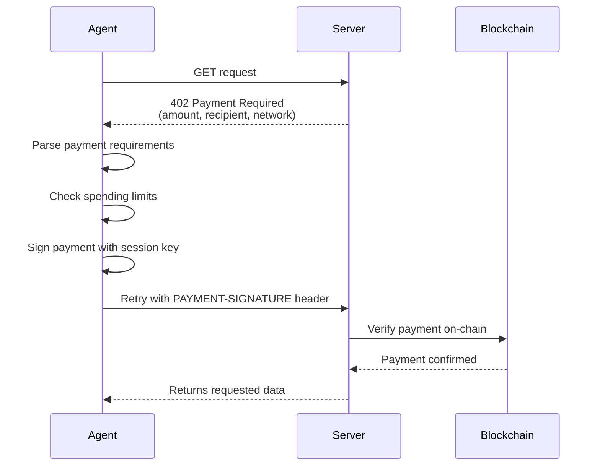

import { Callout, Note, Info, Warning, Tip, Danger, Tabs, Tab, Cards, Card, CardGroup, Steps, Step, Accordion, AccordionGroup, CodeGroup } from "../../components/mdx"

# Agent Payments

This guide walks through building an autonomous AI agent that can make payments using the Veridex Agent SDK (`@veridex/agentic-payments`), based on real patterns from the [veri_agent](https://github.com/Veridex-Protocol/demo/tree/main/veri_agent) reference implementation — a Gemini-powered AI agent with passkey wallet provisioning and MCP tool integration.

## Overview

The Agent SDK enables AI agents to:

- **Pay for APIs automatically** via multiple protocols (x402, UCP, ACP, AP2) with auto-detection
- **Expose MCP tools** for integration with AI models (Gemini, Claude, GPT)
- **Register on-chain identity** via ERC-8004 (ERC-721 NFT)
- **Check merchant reputation** before paying (trust gates)
- **Submit reputation feedback** automatically after payments
- **Discover other agents** by capability, chain, or reputation
- **Manage spending limits** with daily and per-transaction caps
- **Use session keys** so the master passkey isn't needed for every payment
- **Accept provisioned sessions** from a frontend dashboard (human-in-the-loop)
- **Monitor spending** with real-time alerts and audit logs
- **Operate across chains** including EVM, Solana, Stacks, Monad, and more

## Prerequisites

```bash
npm install @veridex/agentic-payments
```

You'll also need:
- A registered passkey credential (credentialId, publicKeyX, publicKeyY, keyHash)
- Testnet tokens on your target chain (e.g., USDC on Base Sepolia)

## Architecture: VeriAgent Reference App

The veri_agent app demonstrates a complete agent architecture:

```
┌─────────────────────────────────────────────────┐
│  Frontend (Next.js)                             │
│  - Passkey wallet creation                      │
│  - Budget configuration                         │
│  - Session provisioning → POST /api/provision   │
│  - Chat UI → POST /api/chat                     │
└─────────────┬───────────────────────────────────┘
              │
┌─────────────▼───────────────────────────────────┐
│  Backend (Express)                              │
│  ┌──────────────┐  ┌─────────────────────────┐  │
│  │  VeriAgent    │  │  AgentWallet            │  │
│  │  (Gemini AI)  │  │  (@veridex/agentic-     │  │
│  │  - Chat loop  │  │   payments)             │  │
│  │  - Tool calls │  │  - Session management   │  │
│  │  - Function   │──│  - MCP tools            │  │
│  │    responses   │  │  - x402 payments        │  │
│  └──────────────┘  │  - Balance queries       │  │
│                     └─────────────────────────┘  │
└─────────────────────────────────────────────────┘
```

## 1. Configuration

Define environment variables and build the agent config:

```typescript
// config.ts
import dotenv from 'dotenv';
import { z } from 'zod';

dotenv.config();

const envSchema = z.object({
  GOOGLE_API_KEY: z.string().min(1, "Google API Key is required"),
  VERIDEX_RELAYER_URL: z.string().default('https://relay.veridex.network'),

  // Optional — can be provisioned from frontend instead
  VERIDEX_MASTER_KEY_ID: z.string().optional(),
  VERIDEX_MASTER_PUBLIC_KEY_X: z.string().optional(),
  VERIDEX_MASTER_PUBLIC_KEY_Y: z.string().optional(),
  VERIDEX_MASTER_KEY_HASH: z.string().optional(),

  // Session limits
  VERIDEX_SESSION_DAILY_LIMIT_USD: z.string().default('100').transform(Number),
  VERIDEX_SESSION_TX_LIMIT_USD: z.string().default('25').transform(Number),
  VERIDEX_SESSION_EXPIRY_HOURS: z.string().default('24').transform(Number),

  // RPC URLs for balance checks
  ETHEREUM_SEPOLIA_RPC_URL: z.string().optional(),
  BASE_SEPOLIA_RPC_URL: z.string().optional(),
  OPTIMISM_SEPOLIA_RPC_URL: z.string().optional(),
  ARBITRUM_SEPOLIA_RPC_URL: z.string().optional(),
});

export const env = envSchema.parse(process.env);

export const agentConfig = {
  masterCredential: (env.VERIDEX_MASTER_KEY_ID
    && env.VERIDEX_MASTER_PUBLIC_KEY_X
    && env.VERIDEX_MASTER_PUBLIC_KEY_Y) ? {
    credentialId: env.VERIDEX_MASTER_KEY_ID,
    publicKeyX: BigInt(env.VERIDEX_MASTER_PUBLIC_KEY_X),
    publicKeyY: BigInt(env.VERIDEX_MASTER_PUBLIC_KEY_Y),
    keyHash: env.VERIDEX_MASTER_KEY_HASH || '',
  } : undefined,
  session: {
    dailyLimitUSD: env.VERIDEX_SESSION_DAILY_LIMIT_USD,
    perTransactionLimitUSD: env.VERIDEX_SESSION_TX_LIMIT_USD,
    expiryHours: env.VERIDEX_SESSION_EXPIRY_HOURS,
    allowedChains: [10004, 10002, 10003, 10005], // Base, Eth, Arb, Op Sepolia
  },
  relayerUrl: env.VERIDEX_RELAYER_URL,
};
```

## 2. Create an Agent Wallet (Singleton)

The wallet is created once and reused. It supports two modes: **env-configured** (master credential in env vars) or **frontend-provisioned** (session injected from a dashboard).

```typescript
// wallet.ts
import { createAgentWallet, AgentWallet } from '@veridex/agentic-payments';
import { agentConfig } from './config';

let agentInstance: AgentWallet | null = null;

export async function getAgentWallet(): Promise<AgentWallet> {
  if (agentInstance) return agentInstance;

  const configToUse = {
    ...agentConfig,
    mcp: { enabled: true },  // Enable MCP tool generation
  } as any;

  // If no master credential in env, create a shell wallet
  // that will be provisioned later from the frontend
  if (!configToUse.masterCredential) {
    console.warn('No Master Credential in env. Waiting for provisioning.');
    configToUse.masterCredential = {
      credentialId: 'UNPROVISIONED',
      publicKeyX: 0n,
      publicKeyY: 0n,
      keyHash: '0x0',
    };
  }

  agentInstance = await createAgentWallet(configToUse);
  return agentInstance;
}

// Inject a session from the frontend dashboard
export async function setProvisionedSession(sessionData: any) {
  const wallet = await getAgentWallet();
  await wallet.importSession(sessionData);
  console.log('Session injected into Wallet.');
}

// Check if the wallet has a real (non-mock) session
export function isWalletProvisioned(status: any): boolean {
  if (!status.isValid) return false;
  return status.masterKeyHash
    && status.masterKeyHash !== 'UNPROVISIONED'
    && status.masterKeyHash !== '0x0';
}
```

<Callout type="info">
  The **provisioning flow** allows a human to create a passkey wallet in a dashboard, configure spending limits, generate a session key, and send it to the agent backend. The agent then uses this session key for autonomous payments within the authorized budget.
</Callout>

## 3. MCP Tools + AI Model Integration

The Agent SDK exposes **MCP tools** that can be mapped to any AI model's function calling interface. The veri_agent maps them to Gemini's function declarations:

```typescript
// tools.ts
import { FunctionDeclaration, SchemaType } from '@google/generative-ai';
import { getAgentWallet } from './wallet';

export interface ToolDefinition {
  declaration: FunctionDeclaration;
  execute: (args: any) => Promise<any>;
}

export async function getGeminiTools(): Promise<ToolDefinition[]> {
  const agent = await getAgentWallet();

  // Get MCP tools from the Agent SDK
  const mcpTools = agent.getMCPTools();

  // Map MCP tools to Gemini function declarations
  const tools: ToolDefinition[] = mcpTools.map(tool => ({
    declaration: {
      name: tool.name,
      description: tool.description,
      parameters: {
        type: SchemaType.OBJECT,
        properties: tool.inputSchema.properties as any,
        required: tool.inputSchema.required || [],
      },
    },
    execute: async (args: any) => {
      // Safety: sanitize decimal amounts for veridex_pay
      if (tool.name === 'veridex_pay'
        && typeof args.amount === 'string'
        && args.amount.includes('.')) {
        args.amount = BigInt(Math.floor(parseFloat(args.amount))).toString();
      }

      const result = await tool.handler(args);

      // Serialize BigInts for JSON compatibility
      return JSON.parse(JSON.stringify(result, (key, value) =>
        typeof value === 'bigint' ? value.toString() : value
      ));
    },
  }));

  return tools;
}
```

<Callout type="warning">
  **BigInt serialization**: The Agent SDK returns `bigint` values for token amounts. Always serialize them to strings before passing to AI model APIs (Gemini, OpenAI, etc.) which don't support BigInt in JSON.
</Callout>

### MCP Tools Provided

The `agent.getMCPTools()` method returns tools including:

| Tool Name | Description |
|-----------|-------------|
| `veridex_pay` | Execute a token payment (chain, token, amount, recipient) |
| `veridex_balance` | Check wallet balance on a specific chain |
| `veridex_status` | Get session status and spending limits |
| `veridex_history` | Get payment history |

## 4. AI Agent with Function Calling

The veri_agent uses Gemini with a function-calling loop:

```typescript
// agent.ts
import { GoogleGenerativeAI } from '@google/generative-ai';
import { env } from './config';
import { getGeminiTools, ToolDefinition } from './tools';

export class VeriAgent {
  private model: any;
  private tools: ToolDefinition[] = [];
  private chat: any;

  async initialize() {
    this.tools = await getGeminiTools();

    const genAI = new GoogleGenerativeAI(env.GOOGLE_API_KEY);
    this.model = genAI.getGenerativeModel({
      model: 'gemini-2.5-pro',
      tools: [{
        functionDeclarations: this.tools.map(t => t.declaration),
      }],
    });

    this.chat = this.model.startChat({
      history: [{
        role: 'user',
        parts: [{ text: `You are VeriAgent, a helpful assistant with a crypto wallet.

RULES for 'veridex_pay':
1. AMOUNTS: Convert to atomic units (wei) as integers.
   - USDC (6 decimals): multiply by 1,000,000. Example: 10 USDC -> "10000000"
   - ETH (18 decimals): multiply by 10^18.
2. CHAIN IDs: Use Wormhole Chain IDs:
   - Base Sepolia: 10004, Ethereum Sepolia: 10002
   - Arbitrum Sepolia: 10003, Optimism Sepolia: 10005
3. TOKEN: Use lowercase symbol like "usdc", "eth", "native"
4. Always use 'verify_balance' BEFORE making a large payment.` }],
      }, {
        role: 'model',
        parts: [{ text: 'Understood. I am VeriAgent, ready to assist.' }],
      }],
    });
  }

  async sendMessage(message: string): Promise<string> {
    if (!this.chat) await this.initialize();

    let result = await this.chat.sendMessage(message);
    let response = result.response;

    // Function calling loop
    while (true) {
      const functionCalls = response.functionCalls();
      if (!functionCalls?.length) break;

      for (const call of functionCalls) {
        const tool = this.tools.find(t => t.declaration.name === call.name);
        if (!tool) break;

        let apiResponse;
        try {
          apiResponse = await tool.execute(call.args);
        } catch (e: any) {
          apiResponse = { error: e.message };
        }

        result = await this.chat.sendMessage([{
          functionResponse: {
            name: call.name,
            response: { result: apiResponse },
          },
        }]);
        response = result.response;
      }
    }

    return response.text();
  }
}
```

## 5. Express Server with Provisioning

The backend exposes REST endpoints for status checks, session provisioning, chat, and balance queries:

```typescript
// server.ts
import express from 'express';
import cors from 'cors';
import { z } from 'zod';
import { VeriAgent } from './agent';
import { getAgentWallet, setProvisionedSession, isWalletProvisioned } from './wallet';

const app = express();
app.use(cors());
app.use(express.json());

let agent: VeriAgent | null = null;

// Check if agent is ready
app.get('/api/status', async (req, res) => {
  const wallet = await getAgentWallet();
  const status = wallet.getSessionStatus();
  const ready = isWalletProvisioned(status) && !!agent;
  res.json({ ready, details: status, agentActive: !!agent });
});

// Provision a session from the frontend
app.post('/api/provision', async (req, res) => {
  const { sessionData } = req.body;
  await setProvisionedSession(sessionData);

  // Re-initialize agent with new session
  agent = new VeriAgent();
  await agent.initialize();

  res.json({ success: true });
});

// Chat with the agent
app.post('/api/chat', async (req, res) => {
  if (!agent) {
    return res.status(503).json({ error: 'Agent not initialized. Provision wallet first.' });
  }
  const { message } = req.body;
  const response = await agent.sendMessage(message);
  res.json({ response });
});

// Get multi-chain balances
app.get('/api/wallet/balances', async (req, res) => {
  const wallet = await getAgentWallet();
  const portfolio = await wallet.getMultiChainBalance();
  res.json({ address: wallet.getSessionStatus().address, portfolio });
});

// Get balance for a specific chain
app.get('/api/wallet/balance/:chainId', async (req, res) => {
  const wallet = await getAgentWallet();
  const chainId = parseInt(req.params.chainId);
  const tokens = await wallet.getBalance(chainId);
  res.json({ chainId, tokens });
});

app.listen(3001, () => console.log('VeriAgent backend running on :3001'));
```

## 6. Frontend Provisioning Flow

The frontend dashboard provisions the agent with a session key:

```typescript
// Frontend API calls
const API_URL = 'http://localhost:3001/api';

// Check if agent is ready
export async function checkAgentStatus() {
  const res = await fetch(`${API_URL}/status`);
  return await res.json(); // { ready: boolean, details: SessionStatus }
}

// Provision agent with session from passkey wallet
export async function provisionAgent(sessionData: {
  keyHash: string;
  encryptedPrivateKey: string;
  publicKey: string;
  config: {
    dailyLimitUSD: number;
    perTransactionLimitUSD: number;
    expiryTimestamp: number;
    allowedChains: number[];
  };
  masterKeyHash: string;
}) {
  const res = await fetch(`${API_URL}/provision`, {
    method: 'POST',
    headers: { 'Content-Type': 'application/json' },
    body: JSON.stringify({ sessionData }),
  });
  return await res.json();
}

// Chat with the agent
export async function sendChatMessage(message: string) {
  const res = await fetch(`${API_URL}/chat`, {
    method: 'POST',
    headers: { 'Content-Type': 'application/json' },
    body: JSON.stringify({ message }),
  });
  return await res.json();
}

// Get wallet balances
export async function getWalletBalances() {
  const res = await fetch(`${API_URL}/wallet/balances`);
  return await res.json();
}
```

## 7. Automatic x402 Payments

When the agent uses `agent.fetch()`, x402 payments are handled transparently:

```typescript
// Agent automatically handles 402 Payment Required responses
const response = await agent.fetch('https://paid-api.example.com/market-data');

if (response.ok) {
  const data = await response.json();
  console.log('Got paid data:', data);
}
```

### How x402 Works



## 8. Direct Payments

For payments outside the x402 flow:

```typescript
const receipt = await agent.pay({
  chain: 10004,          // Base Sepolia (Wormhole chain ID)
  token: 'USDC',
  amount: '5000000',     // 5 USDC (6 decimals)
  recipient: '0x742d35Cc6634C0532925a3b844Bc9e7595f5A234',
});

console.log('Tx hash:', receipt.txHash);
console.log('Status:', receipt.status);
```

## 9. Monitor Spending

```typescript
const status = agent.getSessionStatus();

console.log('Session valid:', status.isValid);
console.log('Wallet address:', status.address);
console.log('Daily limit:', `$${status.limits!.dailyLimitUSD}`);
console.log('Spent today:', `$${status.totalSpentUSD.toFixed(2)}`);
console.log('Remaining:', `$${status.remainingDailyLimitUSD.toFixed(2)}`);

// Set up spending alerts
agent.onSpendingAlert((alert) => {
  console.warn(`[ALERT] ${alert.type}: ${alert.message}`);
});
```

## 10. RPC Balance Verification

The veri_agent adds a custom `verify_balance` tool that checks native token balances via direct RPC calls, independent of the SDK:

```typescript
import { ethers } from 'ethers';

const CHAIN_RPC_MAP: Record<number, string | undefined> = {
  10002: process.env.ETHEREUM_SEPOLIA_RPC_URL,
  10004: process.env.BASE_SEPOLIA_RPC_URL,
  10003: process.env.ARBITRUM_SEPOLIA_RPC_URL,
  10005: process.env.OPTIMISM_SEPOLIA_RPC_URL,
};

export async function getBalance(address: string, chainId: number): Promise<string> {
  const rpcUrl = CHAIN_RPC_MAP[chainId];
  if (!rpcUrl) throw new Error(`No RPC URL for chain ${chainId}`);

  const provider = new ethers.JsonRpcProvider(rpcUrl);
  const balance = await provider.getBalance(address);
  return ethers.formatEther(balance);
}
```

## Error Handling

```typescript
import { AgentPaymentError, AgentPaymentErrorCode } from '@veridex/agentic-payments';

try {
  await agent.pay({ chain: 10004, token: 'USDC', amount: '100000000', recipient: '0x...' });
} catch (error) {
  if (error instanceof AgentPaymentError) {
    switch (error.code) {
      case AgentPaymentErrorCode.LIMIT_EXCEEDED:
        console.log('Over budget! Wait for daily reset.');
        break;
      case AgentPaymentErrorCode.INSUFFICIENT_BALANCE:
        console.log('Need more tokens:', error.suggestion);
        break;
      case AgentPaymentErrorCode.SESSION_EXPIRED:
        // Re-initialize agent or request new session from frontend
        break;
      default:
        console.error('Agent error:', error.message);
    }
  }
}
```

## Environment Variables

```bash
# .env
GOOGLE_API_KEY=your-gemini-api-key
VERIDEX_RELAYER_URL=https://relay.veridex.network

# Optional: Master credential (if not using frontend provisioning)
VERIDEX_MASTER_KEY_ID=your-credential-id
VERIDEX_MASTER_PUBLIC_KEY_X=your-public-key-x
VERIDEX_MASTER_PUBLIC_KEY_Y=your-public-key-y
VERIDEX_MASTER_KEY_HASH=your-key-hash

# Session limits
VERIDEX_SESSION_DAILY_LIMIT_USD=100
VERIDEX_SESSION_TX_LIMIT_USD=25
VERIDEX_SESSION_EXPIRY_HOURS=24

# RPC URLs for balance verification
ETHEREUM_SEPOLIA_RPC_URL=https://eth-sepolia.g.alchemy.com/v2/...
BASE_SEPOLIA_RPC_URL=https://base-sepolia.g.alchemy.com/v2/...
OPTIMISM_SEPOLIA_RPC_URL=https://opt-sepolia.g.alchemy.com/v2/...
ARBITRUM_SEPOLIA_RPC_URL=https://arb-sepolia.g.alchemy.com/v2/...
```

## Next Steps

<Cards>
  <Card title="Agent Identity" href="/guides/agent-identity">
    ERC-8004 identity, reputation, and discovery
  </Card>
  <Card title="Agent SDK Reference" href="/api-reference/agent-sdk">
    Complete API documentation
  </Card>
  <Card title="Spending Limits" href="/guides/spending-limits">
    Configure spending safety
  </Card>
  <Card title="React Integration" href="/integrations/react">
    Build the frontend dashboard
  </Card>
</Cards>
