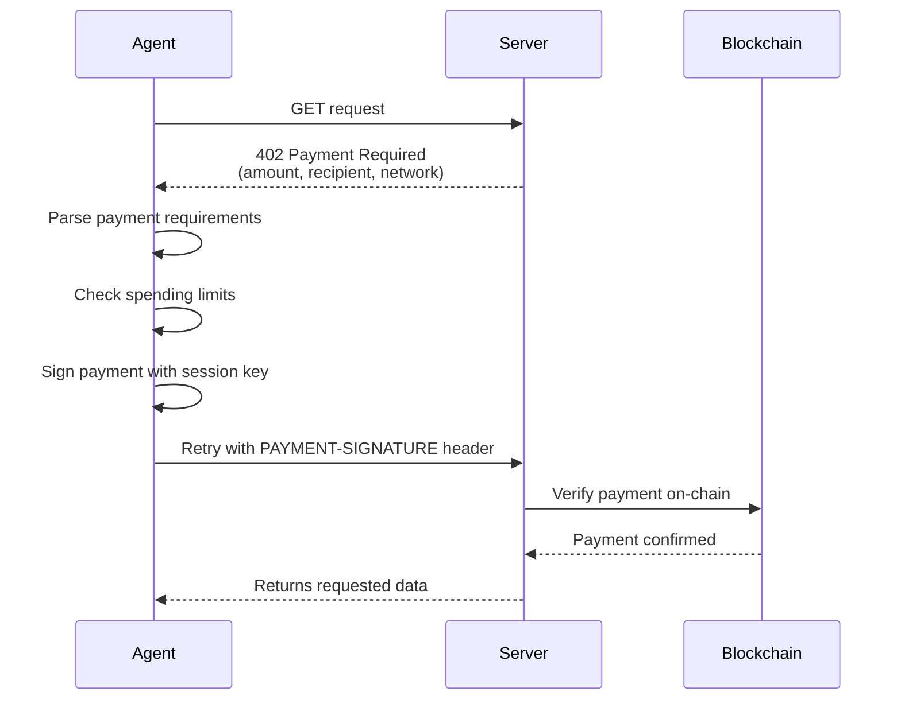

import { Callout, Note, Info, Warning, Tip, Danger, Tabs, Tab, Cards, Card, CardGroup, Steps, Step, Accordion, AccordionGroup, CodeGroup } from "../../components/mdx"

# Agent Payments

This guide walks through building an autonomous AI agent that can make payments using the Veridex Agent SDK (`@veridex/agentic-payments`).

## Overview

The Agent SDK enables AI agents to:

- **Pay for APIs automatically** via multiple protocols (x402, UCP, ACP, AP2) with auto-detection
- **Register on-chain identity** via ERC-8004 (ERC-721 NFT)
- **Check merchant reputation** before paying (trust gates)
- **Submit reputation feedback** automatically after payments
- **Discover other agents** by capability, chain, or reputation
- **Manage spending limits** with daily and per-transaction caps
- **Use session keys** so the master passkey isn't needed for every payment
- **Monitor spending** with real-time alerts and audit logs
- **Operate across chains** including EVM, Solana, Stacks, Monad, and more

## Prerequisites

```bash
npm install @veridex/agentic-payments
```

You'll also need:
- A registered passkey credential (credentialId, publicKeyX, publicKeyY, keyHash)
- Testnet tokens on your target chain (e.g., USDC on Base Sepolia)

## 1. Create an Agent Wallet

```typescript
import { createAgentWallet } from '@veridex/agentic-payments';

const agent = await createAgentWallet({
  masterCredential: {
    credentialId: process.env.CREDENTIAL_ID!,
    publicKeyX: BigInt(process.env.PUBLIC_KEY_X!),
    publicKeyY: BigInt(process.env.PUBLIC_KEY_Y!),
    keyHash: process.env.KEY_HASH!,
  },
  session: {
    dailyLimitUSD: 50,           // Max $50/day
    perTransactionLimitUSD: 10,  // Max $10 per payment
    expiryHours: 24,             // Session lasts 24 hours
    allowedChains: [10004],      // Base Sepolia only
  },
  erc8004: {
    enabled: true,               // Enable on-chain identity
    testnet: true,               // Use testnet registries
    minReputationScore: 30,      // Only pay merchants with 30+ reputation
  },
  relayerUrl: 'https://relayer.veridex.network',
});

console.log('Agent initialized!');
console.log('Session:', agent.getSessionStatus());
```

<Callout type="info">
  The `createAgentWallet` function automatically creates a session key derived from your master credential. The session key has limited permissions defined by the `session` config. When `erc8004` is enabled, the agent also initializes identity and reputation clients for on-chain operations.
</Callout>

## 2. Automatic x402 Payments

The killer feature of the Agent SDK is automatic x402 payment handling. When a server responds with `402 Payment Required`, the agent negotiates and pays automatically.

```typescript
// This URL requires payment — agent handles it transparently
const response = await agent.fetch('https://paid-api.example.com/market-data');

if (response.ok) {
  const data = await response.json();
  console.log('Got paid data:', data);
} else {
  console.error('Request failed:', response.status);
}
```

### How x402 Works



## 3. Direct Payments

For payments outside the x402 flow:

```typescript
// Pay with USDC on Base Sepolia
const receipt = await agent.pay({
  chain: 10004,
  token: 'USDC',
  amount: '5000000',  // 5 USDC (6 decimals)
  recipient: '0x742d35Cc6634C0532925a3b844Bc9e7595f5A234',
});

console.log('Payment confirmed!');
console.log('Tx hash:', receipt.txHash);
console.log('Status:', receipt.status);

// Pay with native ETH
const ethReceipt = await agent.pay({
  chain: 10004,
  token: 'ETH',
  amount: '10000000000000000',  // 0.01 ETH
  recipient: '0x...',
});
```

## 4. Monitor Spending

### Check Session Status

```typescript
const status = agent.getSessionStatus();

console.log('Session valid:', status.isValid);
console.log('Wallet address:', status.address);
console.log('Daily limit:', `$${status.limits!.dailyLimitUSD}`);
console.log('Spent today:', `$${status.totalSpentUSD.toFixed(2)}`);
console.log('Remaining:', `$${status.remainingDailyLimitUSD.toFixed(2)}`);
console.log('Expires:', new Date(status.expiry).toLocaleString());
```

### Set Up Spending Alerts

```typescript
agent.onSpendingAlert((alert) => {
  switch (alert.type) {
    case 'approaching_limit':
      console.warn('Warning: Approaching daily spending limit');
      break;
    case 'limit_exceeded':
      console.error('Blocked: Transaction exceeds spending limit');
      break;
    case 'session_expiring':
      console.warn('Session key expiring soon');
      break;
  }
});
```

### View Payment History

```typescript
const history = await agent.getPaymentHistory({
  limit: 20,
  chain: 10004,
});

for (const payment of history) {
  console.log(`${payment.timestamp}: ${payment.token} ${payment.amount} → ${payment.recipient}`);
  console.log(`  Tx: ${payment.txHash} (${payment.status})`);
}
```

## 5. Check Balances

```typescript
// Single chain balance
const balances = await agent.getBalance(10004);
for (const token of balances) {
  console.log(`${token.symbol}: ${token.formattedBalance}`);
}

// Multi-chain portfolio
const portfolio = await agent.getMultiChainBalance();
console.log('Total USD value:', portfolio.totalUsdValue);
for (const token of portfolio.tokens) {
  console.log(`  ${token.symbol} on ${token.chainName}: ${token.formattedBalance}`);
}
```

## 6. Audit & Compliance

Export payment logs for compliance or debugging:

```typescript
// Export as JSON
const jsonLog = await agent.exportAuditLog('json');
fs.writeFileSync('audit-log.json', jsonLog);

// Export as CSV
const csvLog = await agent.exportAuditLog('csv');
fs.writeFileSync('audit-log.csv', csvLog);
```

## 7. Clean Up

Always revoke sessions when done:

```typescript
await agent.revokeSession();
console.log('Session revoked');
```

## Complete Example: Market Data Agent

```typescript
import { createAgentWallet } from '@veridex/agentic-payments';
import 'dotenv/config';

async function marketDataAgent() {
  // Initialize
  const agent = await createAgentWallet({
    masterCredential: {
      credentialId: process.env.CREDENTIAL_ID!,
      publicKeyX: BigInt(process.env.PUBLIC_KEY_X!),
      publicKeyY: BigInt(process.env.PUBLIC_KEY_Y!),
      keyHash: process.env.KEY_HASH!,
    },
    session: {
      dailyLimitUSD: 25,
      perTransactionLimitUSD: 5,
      expiryHours: 8,
      allowedChains: [10004],
    },
  });

  // Set up monitoring
  agent.onSpendingAlert((alert) => {
    console.warn(`[ALERT] ${alert.type}: ${alert.message}`);
  });

  try {
    // Fetch paid market data (x402)
    console.log('Fetching market data...');
    const response = await agent.fetch('https://data.example.com/api/v1/prices');
    const prices = await response.json();
    console.log('Prices:', prices);

    // Make a payment to a data provider
    console.log('Paying data provider...');
    const receipt = await agent.pay({
      chain: 10004,
      token: 'USDC',
      amount: '1000000', // 1 USDC
      recipient: '0x...',
    });
    console.log('Paid:', receipt.txHash);

    // Check remaining budget
    const status = agent.getSessionStatus();
    console.log(`Budget: $${status.totalSpentUSD.toFixed(2)} / $${status.limits!.dailyLimitUSD}`);

  } finally {
    // Always clean up
    await agent.revokeSession();
    const audit = await agent.exportAuditLog('json');
    console.log('Session ended. Audit log:', audit);
  }
}

marketDataAgent().catch(console.error);
```

## Error Handling

```typescript
import { AgentPaymentError, AgentPaymentErrorCode } from '@veridex/agentic-payments';

try {
  await agent.pay({ chain: 10004, token: 'USDC', amount: '100000000', recipient: '0x...' });
} catch (error) {
  if (error instanceof AgentPaymentError) {
    switch (error.code) {
      case AgentPaymentErrorCode.LIMIT_EXCEEDED:
        console.log('Over budget! Wait for daily reset.');
        break;
      case AgentPaymentErrorCode.INSUFFICIENT_BALANCE:
        console.log('Need more tokens:', error.suggestion);
        break;
      case AgentPaymentErrorCode.SESSION_EXPIRED:
        // Re-initialize agent
        break;
      default:
        console.error('Agent error:', error.message);
    }
  }
}
```

## Next Steps

<Cards>
  <Card title="Agent Identity" href="/guides/agent-identity">
    ERC-8004 identity, reputation, and discovery
  </Card>
  <Card title="Agent SDK Reference" href="/api-reference/agent-sdk">
    Complete API documentation
  </Card>
  <Card title="Spending Limits" href="/guides/spending-limits">
    Configure spending safety
  </Card>
</Cards>
