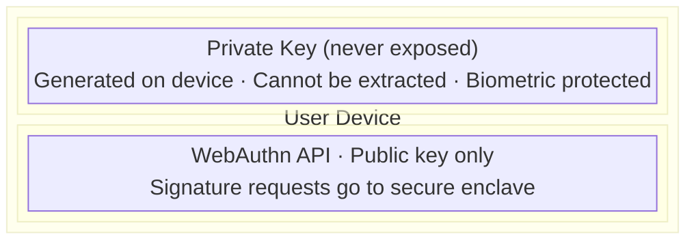
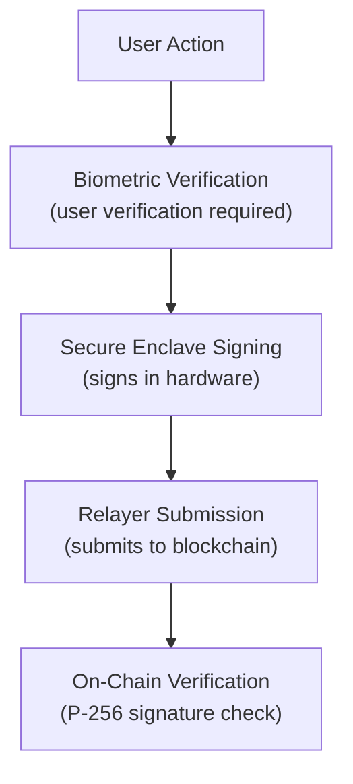

import { Callout } from 'nextra/components'

# Security Audits

Information about Veridex security reviews, bug bounty program, and security practices.

<Callout type="warning" emoji="⚠️">
**Testnet only.** Veridex contracts are currently deployed to six EVM testnets (Base Sepolia, Optimism Sepolia, Arbitrum Sepolia, Ethereum Sepolia, Monad Testnet, Polygon Amoy). **No contracts are deployed to mainnet, and none of the testnet deployments are explorer-verified yet** (see [Threat Model — Known Gaps](/security/threat-model)). A clean third-party audit report is a hard gate before any mainnet launch — see the [Threat Model](/security/threat-model) for current trust boundaries.
</Callout>

## Audit Status

| Component | Reviewer | Scope | Status |
|-----------|----------|-------|--------|
| SDK (`@veridex/sdk`) | Internal | Signing, VAA construction, relayer client, session key storage | Continuous internal review |
| Relayer (`@veridex/relayer`) | Internal | API auth, policy engine, signature verification, replay protection | Continuous internal review |
| Agent Runtime (`@veridex/agents`) | Internal | Policy enforcement, tool safety classes, budget engine | Continuous internal review |

## Focus Areas

**EVM Contracts**
- P-256 / secp256r1 Passkey signature verification (`WebAuthn.sol`)
- Session key registration, revocation, and per-tx value bounds
- Wormhole VAA authenticity and replay protection
- Account abstraction and vault ownership transitions
- Reentrancy, access control, and storage layout safety

**SDK**
- WebAuthn credential handling and origin pinning
- Session key storage (browser, React Native, Node)
- Deterministic transaction construction
- Relayer client retry and failure isolation

**Relayer**
- API key authentication and rate limiting
- Policy engine evaluation and cumulative budget tracking
- VAA signature verification before submission
- Audit log integrity

## Security Practices

### Development

- **Code Review**: All changes require peer review; security-sensitive changes require a second reviewer.
- **Testing**: Unit, integration, and fuzz tests (see [`packages/contracts/evm/test/`](https://github.com/Veridex-Protocol/demo/tree/dev/packages/contracts/evm/test)).
- **Static Analysis**: Slither, solhint, and ESLint run in CI on every PR.
- **Dependencies**: Weekly automated audits of npm and Foundry dependencies.

### Cryptography

- **P-256 (secp256r1)**: WebAuthn-standard curve for Passkey signatures.
- **No custom cryptography**: All primitives come from audited libraries (OpenZeppelin, Wormhole SDK, @simplewebauthn).
- **Secure random**: Platform-provided CSPRNGs only.

### Infrastructure

- **TLS 1.3** on all public endpoints.
- **API-key rate limiting** at the relayer edge.
- **Structured audit logging** with tamper-evident hash chaining (see [Threat Model](/security/threat-model)).
- **Documented incident response** with 24-hour acknowledgement SLA.

## Bug Bounty Program

<Callout type="info" emoji="🐞">
The formal bounty program launches alongside the Trail of Bits report. Until then, we pay discretionary bounties for valid findings — email `security@veridex.network` with a PoC and we will respond within 24 hours.
</Callout>

### Planned Scope (post-mainnet)

**In Scope**
- Smart contracts on mainnet
- SDK security issues
- Relayer API vulnerabilities
- Cross-chain bridge logic
- Agent runtime policy bypasses

**Out of Scope**
- Third-party services
- Social engineering
- DoS / volumetric attacks
- Issues already publicly disclosed

### Planned Rewards

| Severity | Reward |
|----------|--------|
| Critical | Up to $50,000 |
| High | Up to $20,000 |
| Medium | Up to $5,000 |
| Low | Up to $1,000 |

Severity is determined by Veridex using the Immunefi classification system. Interim discretionary bounties use the same table, prorated for testnet scope.

### Responsible Disclosure

Please report security issues to: **security@veridex.network**

Do NOT:
- Publicly disclose before we've addressed the issue
- Access or modify user data
- Disrupt service availability

We commit to:
- Acknowledge receipt within 24 hours
- Provide initial assessment within 72 hours
- Work with you on disclosure timeline
- Credit researchers (if desired)

## Known Issues & Mitigations

### Passkey Platform Support

**Issue:** Not all platforms support P-256 passkeys equally.

**Mitigation:** 
- Clear messaging about supported platforms
- Fallback guidance for unsupported browsers
- Testing on all major platforms

### Cross-Chain Latency

**Issue:** Cross-chain operations have inherent latency.

**Mitigation:**
- Clear UI feedback during cross-chain operations
- Transaction status tracking
- Retry mechanisms for failed operations

## Security Architecture

### Passkey Security

### Transaction Flow

## Compliance

### Standards

Veridex implements against — but has not yet been formally certified for — the following standards:

- **WebAuthn Level 2** (W3C): web authentication and passkey signature verification
- **FIDO2**: cross-platform authentication
- **EIP-4337**: account abstraction

Conformance claims will be updated once third-party certification is complete.

### Privacy

- No private key storage on servers
- Minimal personal data collection
- Credential IDs are anonymized

## Contact

**Security Issues:** security@veridex.network

**General Inquiries:** hello@veridex.network

**Emergency:** [Contact form on website]

---

*Last updated: December 2024*
