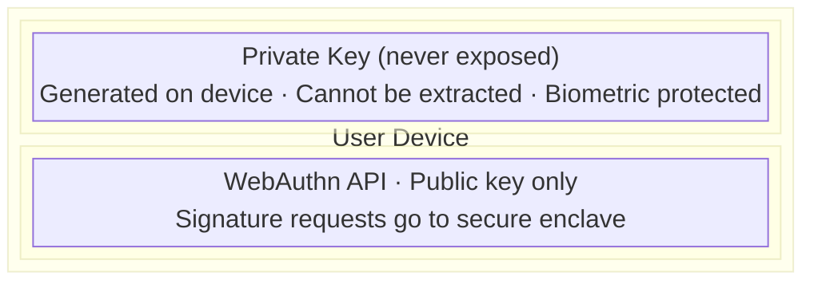
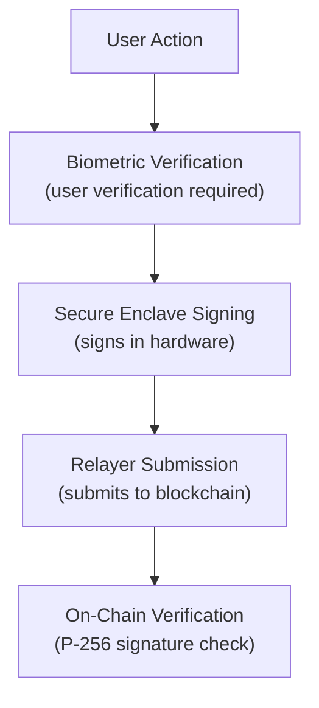

# Security Audits

Information about Veridex security audits, bug bounty program, and security practices.

## Audit Status

| Component | Auditor | Status | Date |
|-----------|---------|--------|------|
| Smart Contracts | TBD | Planned | Q1 2025 |
| SDK | Internal | Ongoing | - |
| Relayer | Internal | Ongoing | - |

## Planned Audits

### Smart Contract Audit

We are planning a comprehensive audit of our EVM smart contracts:

**Scope:**
- VaultFactory.sol
- PasskeyVault.sol
- Paymaster.sol
- Session key management
- Cross-chain bridge integration

**Focus Areas:**
- Passkey signature verification (P-256/secp256r1)
- Account abstraction implementation
- Session key constraints
- Cross-chain message handling
- Reentrancy protection
- Access control

### SDK Security Review

**Scope:**
- WebAuthn credential handling
- Signature generation
- Transaction construction
- State management

## Security Practices

### Development

- **Code Review**: All code changes require peer review
- **Testing**: Comprehensive unit and integration tests
- **Static Analysis**: Automated security scanning
- **Dependencies**: Regular dependency audits and updates

### Cryptography

- **P-256 (secp256r1)**: Standard curve used by WebAuthn
- **No custom cryptography**: Using well-audited libraries
- **Secure random**: Platform-provided secure random number generation

### Infrastructure

- **HTTPS only**: All API communication encrypted
- **Rate limiting**: Protection against abuse
- **Monitoring**: Real-time security monitoring
- **Incident response**: Documented incident response plan

## Bug Bounty Program

### Overview

We are launching a bug bounty program to reward security researchers who help us identify vulnerabilities.

**Status:** Coming Soon

### Scope (Planned)

**In Scope:**
- Smart contracts on mainnet
- SDK security issues
- Relayer API vulnerabilities
- Cross-chain bridge logic

**Out of Scope:**
- Third-party services
- Social engineering
- DoS attacks
- Issues already reported

### Rewards (Planned)

| Severity | Reward |
|----------|--------|
| Critical | Up to $50,000 |
| High | Up to $20,000 |
| Medium | Up to $5,000 |
| Low | Up to $1,000 |

### Responsible Disclosure

Please report security issues to: **security@veridex.network**

Do NOT:
- Publicly disclose before we've addressed the issue
- Access or modify user data
- Disrupt service availability

We commit to:
- Acknowledge receipt within 24 hours
- Provide initial assessment within 72 hours
- Work with you on disclosure timeline
- Credit researchers (if desired)

## Known Issues & Mitigations

### Passkey Platform Support

**Issue:** Not all platforms support P-256 passkeys equally.

**Mitigation:** 
- Clear messaging about supported platforms
- Fallback guidance for unsupported browsers
- Testing on all major platforms

### Cross-Chain Latency

**Issue:** Cross-chain operations have inherent latency.

**Mitigation:**
- Clear UI feedback during cross-chain operations
- Transaction status tracking
- Retry mechanisms for failed operations

## Security Architecture

### Passkey Security

### Transaction Flow

## Compliance

### Standards

- **WebAuthn Level 2**: W3C standard for web authentication
- **FIDO2**: Cross-platform authentication standard
- **EIP-4337**: Account abstraction standard

### Privacy

- No private key storage on servers
- Minimal personal data collection
- Credential IDs are anonymized

## Contact

**Security Issues:** security@veridex.network

**General Inquiries:** hello@veridex.network

**Emergency:** [Contact form on website]

---

*Last updated: December 2024*
