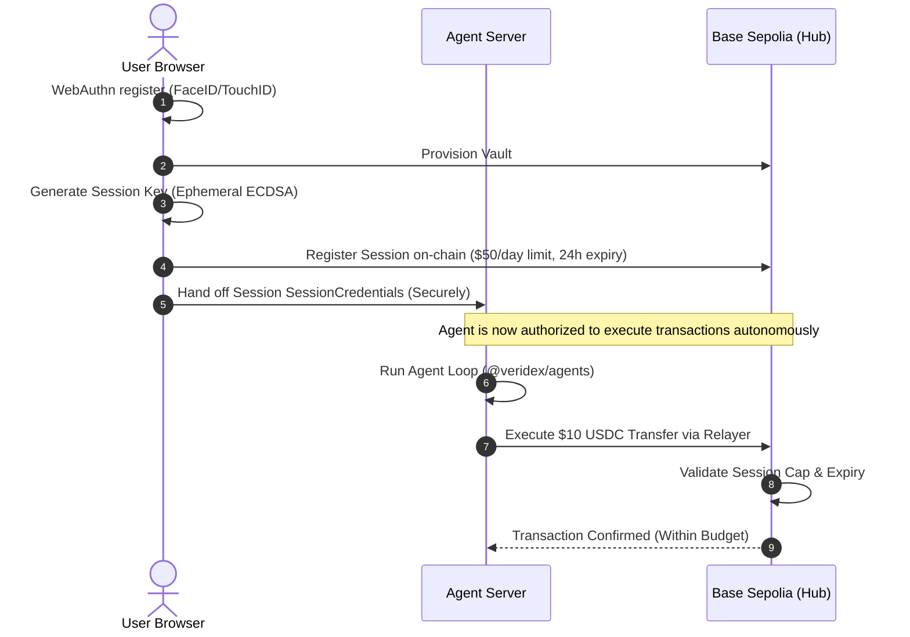

import { Callout, Steps, CodeGroup, Tip, Warning, Info } from "../../components/mdx"

# AI Agent with a $50/day USDC Budget

In this tutorial, you will build an autonomous AI agent that can spend up to **$50/day in USDC** on Base Sepolia to perform operations like paying suppliers, executing on-chain swaps, or buying resources. 

The user authorizes this budget once using their **FaceID/TouchID** (creating an on-chain **Session Key**). The agent runs autonomously on the server. If the agent is compromised or behaves unexpectedly, the user can revoke the session in a single transaction, immediately freezing all outbound movement.

We will use the **Veridex Agents Framework** (`@veridex/agents`) and **Agentic Payments SDK** (`@veridex/agentic-payments`) to build a secure runtime that enforces limits, registers trace-level reasoning for every transaction, and manages context volume to prevent decay.

---

## Architecture Flow

The execution model cleanly separates the user's high-security master key (FaceID/TouchID passkey) from the autonomous server-side agent's key.



---

## Prerequisites

Ensure you have the following installed in your workspace:

- Node.js 18+ or Bun
- A browser supporting WebAuthn/Passkeys (Chrome 108+, Safari 16+)
- A [Google Gemini API Key](https://aistudio.google.com/apikey) or [OpenAI API Key](https://platform.openai.com/api-keys)

```bash
# Browser packages
npm install @veridex/sdk @veridex/react ethers

# Server packages
npm install @veridex/agents @veridex/agentic-payments zod
```

---

<Steps>

### Step 1: Create the Browser-Side Wallet

The user first needs a Veridex vault. We'll build a React page that registers the user with a passkey, gets their deterministic vault address, and establishes an active developer context.

```tsx
// frontend/components/AgentProvisioner.tsx
import { usePasskey, useVault } from '@veridex/react';
import { useState } from 'react';

export function AgentProvisioner() {
  const { register, credential } = usePasskey();
  const { address } = useVault();
  const [session, setSession] = useState<any>(null);

  if (!credential) {
    return (
      <div className="vdx-card">
        <h3>1. Create Passkey Wallet</h3>
        <p>Register a WebAuthn vault on Base Sepolia. No seed phrase required.</p>
        <button className="vdx-btn" onClick={() => register('user@example.com', 'My Agent Vault')}>
          Create Vault
        </button>
      </div>
    );
  }

  return (
    <div className="vdx-card">
      <h3>Vault Active</h3>
      <code className="block bg-black/10 p-2 rounded text-sm">{address}</code>
      {/* Proceed to Step 2 */}
    </div>
  );
}
```

---

### Step 2: Mint the $50/Day Session Key

Next, we generate an ephemeral ECDSA session key in the browser, register its authorization parameters on-chain (limit: $50 USD, token: USDC, duration: 24h), and transfer the session credentials to our server.

```tsx
// frontend/components/AgentProvisioner.tsx (continued)
import { SessionManager, EVMHubClientAdapter, createSDK } from '@veridex/sdk';
import { parseUnits, JsonRpcProvider } from 'ethers';

export function SessionCreator({ sdk, credential }: { sdk: any, credential: any }) {
  const [status, setStatus] = useState('');
  
  const createAndRegisterSession = async () => {
    setStatus('Creating session key...');
    const provider = new JsonRpcProvider('https://sepolia.base.org');
    
    // We use a public relayer adapter to register our session key on-chain gaslessly
    const hubClient = new EVMHubClientAdapter(sdk.getChainClient() as any);
    
    const manager = new SessionManager(
      credential,
      hubClient,
      (challenge) => sdk.passkey.sign(challenge),
      { 
        duration: 86400, // 24 hours
        // USDC uses 6 decimals on-chain. $50 USDC = 50 * 10^6
        maxValue: parseUnits('50', 6), 
        allowedTokens: ['0x036CbD53842c5426634e7929541eC2318f3dCF7e'] // USDC on Base Sepolia
      }
    );

    const session = await manager.createSession();
    setStatus('Syncing with agent server...');

    // Post session credentials to the server
    const res = await fetch('/api/agent/provision', {
      method: 'POST',
      headers: { 'Content-Type': 'application/json' },
      body: JSON.stringify({
        vaultAddress: sdk.getVaultAddress(),
        sessionCredentials: session.serialize() // Encrypted/serialized session parameters
      }),
    });

    if (res.ok) setStatus('Agent Active and Budgeted!');
    else setStatus('Failed to provision agent server.');
  };

  return (
    <div className="vdx-card mt-4">
      <h3>2. Authorize $50/Day Budget</h3>
      <p>Mints an on-chain Session Key that restricts the agent server's actions.</p>
      <button className="vdx-btn vdx-btn-primary" onClick={createAndRegisterSession}>
        Authorize Agent
      </button>
      {status && <p className="mt-2 text-sm">{status}</p>}
    </div>
  );
}
```

---

### Step 3: Initialize the Server-Side Agent Runtime

On our server, we receive the session credentials and load them into `@veridex/agentic-payments` to initialize the `AgentWallet`. We then wrap it in the `@veridex/agents` general-purpose runtime.

```typescript
// server/agent.ts
import { createAgent, OpenAIProvider } from '@veridex/agents';
import { createAgentWallet } from '@veridex/agentic-payments';
import { createSDK } from '@veridex/sdk';
import { payTool, balanceTool } from './tools';

export async function startAutonomousAgent(vaultAddress: string, sessionCredentialsHex: string) {
  // 1. Initialize core Veridex protocol primitives
  const sdk = createSDK('base', { network: 'testnet' });
  
  const wallet = await createAgentWallet({
    vaultAddress,
    sessionCredentials: sessionCredentialsHex,
    sdk
  });

  // 2. Initialize the safe agentic runtime
  const agent = createAgent(
    {
      id: `agent-${vaultAddress.slice(0, 8)}`,
      name: 'Budgeted Swapper & Purchaser',
      model: { provider: 'openai', model: 'gpt-4o' },
      instructions: `
        You are an autonomous treasury and purchasing assistant.
        You have an active daily limit of $50 USDC. 
        You spend autonomously to execute the user's tasks.
        Before every transfer, explain your exact reasoning to the user.
        Never exceed your daily cap.
      `,
      tools: [
        payTool(wallet),
        balanceTool(wallet)
      ],
      // Hard stop after 8 reasoning loops to prevent cost or loop runaways
      maxTurns: 8,
      policies: [
        // Policies are evaluated in the runtime before tool invocation
        { type: 'maxRunSpendUSD', params: { limit: 50 } },
        { type: 'blockSafetyClasses', params: { safetyClasses: ['destructive', 'privileged'] } }
      ]
    },
    {
      modelProviders: {
        openai: new OpenAIProvider({ apiKey: process.env.OPENAI_API_KEY }),
      },
      enableTracing: true,
      enableCheckpoints: true
    }
  );

  return agent;
}
```

---

### Step 4: Define Budget-Aware Tools

Every tool provided to `@veridex/agents` must specify a strict input schema using **Zod** and a designated **safety class**. This ensures that the policy engine can filter and restrict calls before execution starts.

```typescript
// server/tools.ts
import { tool } from '@veridex/agents';
import { AgentWallet } from '@veridex/agentic-payments';
import { parseUnits } from 'ethers';
import { z } from 'zod';

export const balanceTool = (wallet: AgentWallet) =>
  tool({
    name: 'check_usdc_balance',
    description: 'Check your available USDC balance on Base',
    input: z.object({}),
    safetyClass: 'read',
    async execute() {
      const balance = await wallet.getBalance('USDC');
      return {
        success: true,
        llmOutput: `Available balance: ${balance.formatted} USDC. Limit spent today: $${wallet.getDailySpent()}/$50.`,
      };
    },
  });

export const payTool = (wallet: AgentWallet) =>
  tool({
    name: 'make_usdc_payment',
    description: 'Autonomous payment in USDC up to your daily budget limit',
    input: z.object({
      recipient: z.string().regex(/^0x[a-fA-F0-9]{40}$/, 'Invalid EVM address'),
      amountUSD: z.number().positive().max(50, 'Cannot exceed daily limit'),
      purpose: z.string().min(5, 'A clear reason is required for trace auditing'),
    }),
    safetyClass: 'financial',
    async execute({ input }) {
      try {
        // Enforce reasoning capture
        const traceReasoning = `Autonomous Payment: ${input.purpose}. Daily cumulative spent: $${wallet.getDailySpent()}`;
        
        const tx = await wallet.pay({
          recipient: input.recipient,
          amount: parseUnits(input.amountUSD.toString(), 6), // USDC uses 6 decimals
          token: 'USDC',
          reasoning: traceReasoning
        });

        return {
          success: true,
          llmOutput: `Successfully transferred ${input.amountUSD} USDC to ${input.recipient}. Hash: ${tx.transactionHash}`,
        };
      } catch (err: any) {
        return {
          success: false,
          llmOutput: `Payment failed: ${err.message}`,
        };
      }
    },
  });
```

---

### Step 5: Run the Agent & Prevent Context Explosion

We run the agent simply by calling `agent.run(prompt)`. 

<Tip>
  **The Root Theorem of Context Engineering** (Schick, 2026) dictates that an agent's reasoning performance and tool precision degrade monotonically as its in-context token count increases. To avoid hitting this "degradation cliff" over long-running sessions, `@veridex/agents` includes an active **Context Compiler**.
</Tip>

When executing a run, Veridex continuously monitors the token footprint of the run transcript. If the conversation thread exceeds the effective context window ($V_e$), the `ContextCompiler` automatically:

1. **Summarizes** older turn segments.
2. **Compresses** tool outputs into high-level declarative state.
3. **Sheds** redundant intermediary tokens.
4. **Distills** episodic observations into permanent **Semantic Memory** records.

```typescript
// server/route.ts
import { NextRequest, NextResponse } from 'next/server';
import { startAutonomousAgent } from './agent';

export async function POST(req: NextRequest) {
  const { vaultAddress, sessionCredentials, prompt } = await req.json();

  const agent = await startAutonomousAgent(vaultAddress, sessionCredentials);

  // Compile and run the agent loop
  const result = await agent.run(prompt);

  // Return the terminal outcome and the audit-ready Trace Log
  return NextResponse.json({
    output: result.output,
    state: result.run.state, // e.g. "completed" | "suspended"
    traceId: result.run.traceId,
    tokensUsed: result.run.tokensUsed
  });
}
```

</Steps>

---

## What Happens During a Compromise?

If the agent server is hacked, or if a **Tool Poisoning Attack (TPA)** tricks the model into making unintended payments, multiple nested defense lines trigger immediately:

| Layer | Defense Mechanism | Failure Outcome |
|---|---|---|
| **L1: Model Instructions** | Reasoning constraints within the prompt. | Weakest; can be bypassed via advanced jailbreaks. |
| **L2: Runtime Policy Engine** | Restricts tool safety classes (`maxRunSpendUSD`). | **Blocked.** The runtime denies the tool proposal before the model can execute it. |
| **L3: Smart Contract Session** | On-chain verification of daily spending cap ($50 USDC). | **Blocked.** The Base blockchain refuses to execute the transaction, regardless of model instructions. |
| **L4: Instant Revocation** | One-click browser tx revoking the ephemeral session key. | **Dead Switch.** All future agent server requests fail to sign on-chain. |

To learn how to monitor active agent reasoning traces or export signed evidence packages to a SIEM platform, proceed to the [Operator Quickstart](/quickstarts/operator).
