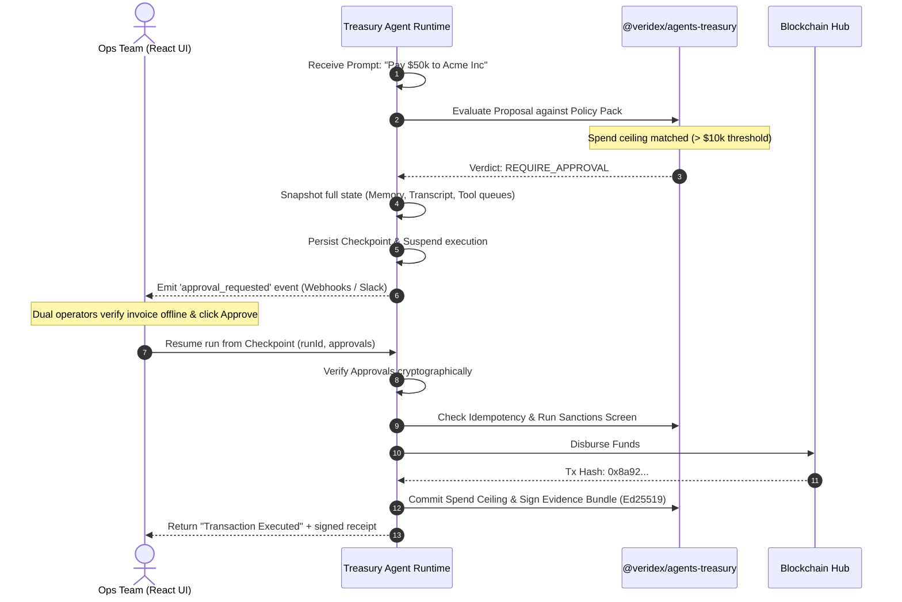

import { Callout, Steps, CodeGroup, Tip, Warning, Info, Danger } from "../../components/mdx"

# Treasury Workflow with Dual Approval

Treasury money-movement is the highest-stakes application of AI agents in production. A single bug—such as double-execution during network retries, payment to a sanctioned entity, or a hijacked prompt—can result in catastrophic losses.

In this tutorial, you will build a production-grade, risk-gated **Treasury Agent** that:
- Executes transfers under **$10,000** instantly.
- **Suspends** and **checkpoints** any execution proposal above **$10,000**, emitting a request for dual human approval.
- Restarts and resumes cleanly once operators approve, guaranteeing **idempotency** (zero double-payments).
- Automatically screens counterparties against **sanctions registries** and seals every execution with an offline-verifiable, **Ed25519-signed Evidence Bundle**.

We will build this using `@veridex/agents` (the core runtime) and `@veridex/agents-treasury` (the enterprise financial security toolkit).

---

## Technical Flow

The diagram below details the stateful suspend-resume architecture, showing how checkpoints preserve state across asynchronous human approvals.



---

## Installation & Setup

Install the core agent framework and the specialized treasury companion package:

```bash
npm install @veridex/agents @veridex/agents-treasury zod ethers
```

---

<Steps>

### Step 1: Configure the Treasury Kit

The `createTreasuryKit` factory bundles five critical financial-security layers into a single, cohesive plugin. We define spending ceilings, an idempotency database, sanctions screening, and our dual-approval threshold ($10,000 USD).

```typescript
// server/treasury.ts
import { 
  createTreasuryKit, 
  InMemoryIdempotencyStore, 
  SpendCeilings, 
  TimeLockManager, 
  NoopSanctionScreener, // swap for OFAC/Chainalysis adapters in production
  Ed25519EvidenceSigner 
} from '@veridex/agents-treasury';
import { readFileSync } from 'fs';

// Load enterprise-grade Ed25519 signing keys for evidence validation
const privateKey = readFileSync('/secrets/evidence-signer.pem');
const publicKey = readFileSync('/secrets/evidence-signer-pub.pem');

export const treasuryKit = createTreasuryKit({
  appId: 'treasury-prod-01',
  runId: 'ops-workflow',
  agentId: 'treasury-bot',
  
  // 1. Guaranteed single-execution under retries
  idempotency: new InMemoryIdempotencyStore(),
  
  // 2. Velocity and total spend tracking (limits per transfer / day)
  ceilings: new SpendCeilings({
    perTransferUsdMicro: 100_000_000_000n, // Max single transfer $100,000
    dayUsdMicro:         500_000_000_000n  // Max daily limit $500,000
  }),
  
  // 3. 60-second time-lock to allow revocations on high-value actions
  timeLock: new TimeLockManager({ baseDelaySec: 60 }),
  
  // 4. Sanctions screen block list
  sanctions: new NoopSanctionScreener(),
  
  // 5. Crytographically-signed Evidence Bundler config
  evidenceSigner: new Ed25519EvidenceSigner({
    privateKey,
    publicKey,
    keyId: 'treasury-ev-key-2026'
  }),
  
  // 6. Dual approval required for transfers exceeding $10,000 USD
  // All monetary parameters in the treasury kit are measured in micro-USD (10^6)
  dualApprovalAbove: { amountUsdMicro: 10_000_000_000n } // $10,000 USD
});
```

---

### Step 2: Initialize the Governed Agent Runtime

We import the pre-built `tools` and `policyRules` from our `treasuryKit`, weaving them directly into `@veridex/agents`.

```typescript
// server/agent.ts
import { createAgent, OpenAIProvider } from '@veridex/agents';
import { treasuryKit } from './treasury';

export const agent = createAgent(
  {
    id: 'enterprise-treasury-agent',
    name: 'Enterprise Treasury Agent',
    model: { provider: 'openai', model: 'gpt-4o' },
    instructions: `
      You are an enterprise treasury agent.
      You process supplier payouts and execute asset redistributions.
      You must obey all spending limits and sanctions policies.
      If a transfer exceeds $10,000, explain to the user that it has been paused for approval.
    `,
    // Tools and policies are composite: they inherit all treasury rules automatically
    tools: [...treasuryKit.tools],
    policies: [...treasuryKit.policyRules],
    maxTurns: 10
  },
  {
    modelProviders: {
      openai: new OpenAIProvider({ apiKey: process.env.OPENAI_API_KEY }),
    },
    // We must enable checkpoints to store the execution state during human suspension
    enableCheckpoints: true,
    enableTracing: true,
    plugins: [treasuryKit.plugin]
  }
);
```

---

### Step 3: Handle Suspensions & Emit Approval Requests

When we run the agent with a transfer request that violates our $10,000 threshold, the policy engine suspends execution. The run shifts to `waiting_for_approval`, and we capture the persistent `checkpointId`.

```typescript
// server/route.ts
import { NextRequest, NextResponse } from 'next/server';
import { agent } from './agent';

export async function POST(req: NextRequest) {
  const { prompt } = await req.json();

  // Execute the run loop
  const result = await agent.run(prompt);

  // Check if the agent's run was suspended by our treasury policies
  if (result.run.state === 'waiting_for_approval') {
    const checkpointId = result.run.checkpointId;
    const approvalId = result.run.approvalId; // Id of the matching policy trigger
    
    // Post details to our Slack channel or approval database
    await notifyOpsTeam({
      runId: result.run.id,
      checkpointId,
      approvalId,
      proposedTransfer: result.run.metadata.proposedAction, // Auto-extracted by treasury plugin
      reasoning: result.run.reasoning
    });

    return NextResponse.json({
      status: 'SUSPENDED',
      message: 'This transfer exceeds $10,000 and requires dual human approval.',
      runId: result.run.id,
      checkpointId
    });
  }

  return NextResponse.json({
    status: 'COMPLETED',
    output: result.output,
    txHash: result.run.metadata.txHash
  });
}
```

---

### Step 4: Resume Execution Safely

Once dual approvers verify the payment and authorize it from their dashboard, we resume the agent directly from the checkpoint. The agent bypasses the model call and immediately jumps into executing the approved transaction.

```typescript
// server/resume-route.ts
import { NextRequest, NextResponse } from 'next/server';
import { agent } from './agent';

export async function POST(req: NextRequest) {
  const { checkpointId, approvals } = await req.json();
  
  // approvals is an array representing dual approvals:
  // [{ approver: "alice@acme.com", signature: "..." }, { approver: "bob@acme.com", signature: "..." }]

  const resumedResult = await agent.resumeFromCheckpoint(checkpointId, {
    approval: {
      approved: true,
      approvers: approvals.map((a: any) => a.approver),
      metadata: { signatures: approvals }
    }
  });

  // Verify that the run finalized successfully
  if (resumedResult.run.state === 'completed') {
    
    // Extract the cryptographically-signed Evidence Bundle (receipt)
    const evidenceBundle = resumedResult.run.metadata.evidenceBundle;

    return NextResponse.json({
      status: 'EXECUTED',
      output: resumedResult.output,
      receipt: evidenceBundle // Offline-verifiable RFC 8785 JSON bundle
    });
  }

  return NextResponse.json({
    status: 'FAILED',
    error: resumedResult.run.error
  });
}
```

---

### Step 5: Cryptographic Receipt Verification

Every completed treasury action registers an **Evidence Bundle**. Because this bundle is cryptographically signed using our Ed25519 keys, any auditor or third-party bank can verify its validity offline without access to our database.

```typescript
// auditing/verify-receipt.ts
import { verifyEvidenceBundle } from '@veridex/agents-treasury';
import { readFileSync } from 'fs';

const publicKey = readFileSync('./evidence-signer-pub.pem');
const receiptJson = readFileSync('./receipt-01HF8.json', 'utf8');

async function auditTransaction() {
  const bundle = JSON.parse(receiptJson);
  
  const isAuthentic = await verifyEvidenceBundle(bundle, { publicKey });
  
  if (isAuthentic) {
    console.log('✅ RECEIPT VALID');
    console.log('Merchant:', bundle.proposal.recipient);
    console.log('Reasoning:', bundle.proposal.reasoning);
    console.log('Signed At:', new Date(bundle.timestamp).toISOString());
  } else {
    console.error('❌ TAMPER DETECTED: Receipt signatures do not match hashes.');
  }
}
```

</Steps>

---

<Danger>
  **Idempotency is Non-Negotiable.** If the network drops after Step 4, executing the same transaction again without an idempotency key would result in a double-spend. The `InMemoryIdempotencyStore` (or `PostgresIdempotencyStore`) integrated into our `treasuryKit` records the unique intent hash on Step 1. Any incoming execution payload with a matching hash is safely rejected or returns the original cached result, entirely neutralizing double-spend vectors.
</Danger>

To see how to write custom policy filters or explore other security mechanisms, visit the [SDK Policies Reference](/sdks/agents-framework#tools--safety-classes).
